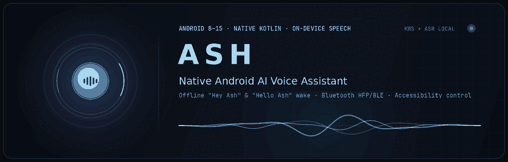
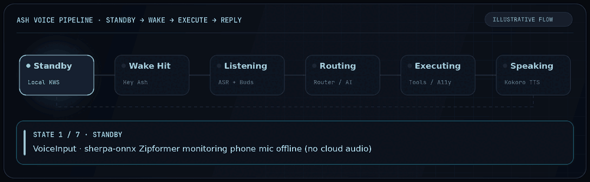
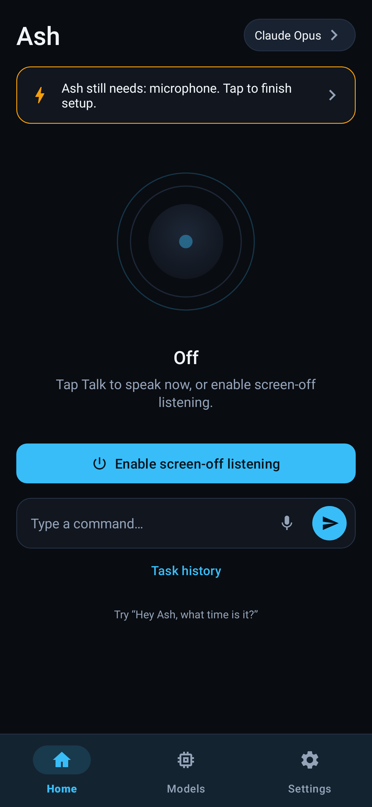
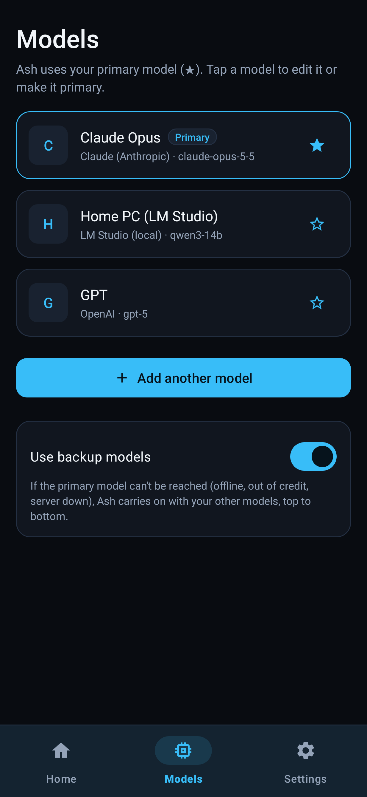
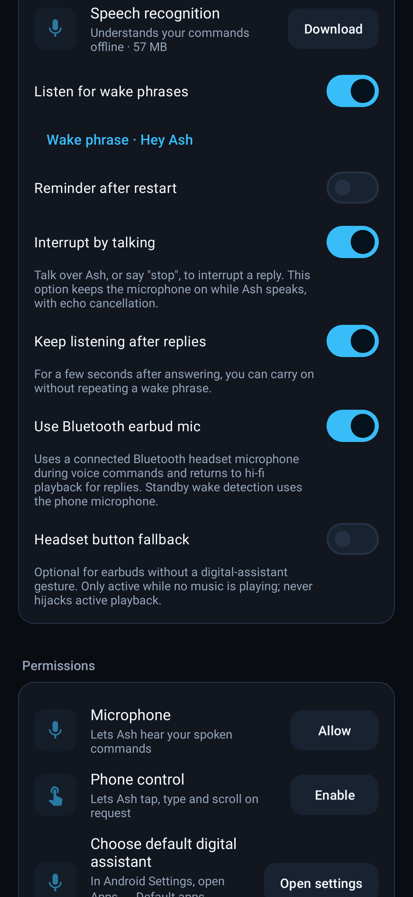
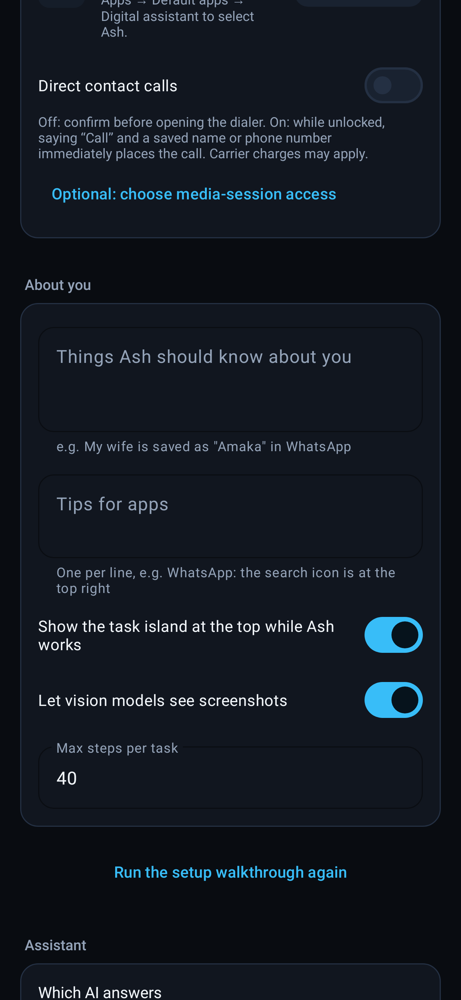
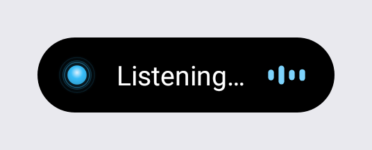
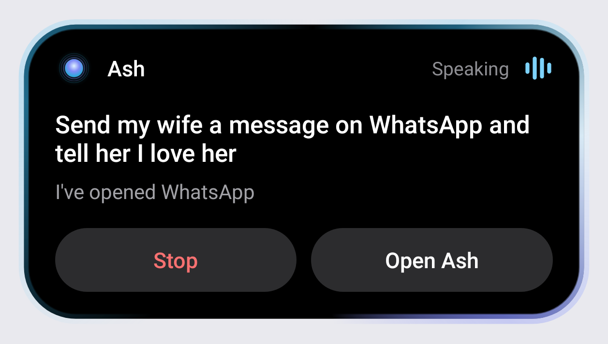
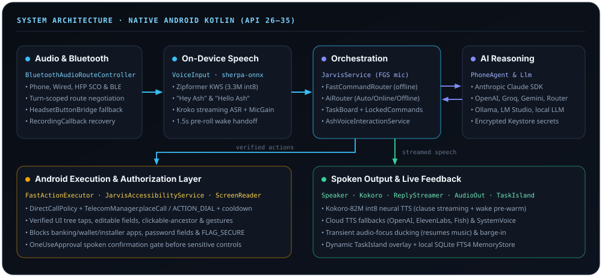
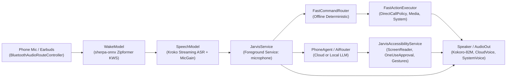

<div align="center">

<a href="assets/readme/ash-hero-static.png">
  
</a>

<br />
<br />

**A native Kotlin AI voice assistant for Android with offline wake-word detection, on-device speech recognition and synthesis, Bluetooth headset routing, and user-authorized phone control.**

<br />

[](LICENSE)
[-0F172A?style=flat-square&labelColor=1E293B&color=34D399)](#device-and-android-compatibility)
[](#technology-stack)
[](#project-status)

[Overview](#voice-interaction-flow) · [Capabilities](#key-capabilities) · [Screenshots](#application-interface) · [Architecture](#system-architecture) · [Build & Install](#building-from-source) · [Security](#security-and-privacy)

</div>

---

## Project Status

Ash is an active personal-use Android engineering project built on [Jarvis](https://github.com/judejulius/jarvis) with native Kotlin Bluetooth routing concepts adapted from [Yunto](https://github.com/lovisschmidt/yunto). It is **not** a finished Play Store release; every capability below is categorized by its actual verification state.

| Area | Status | Evidence |
|---|---|---|
| Native Kotlin build, unit tests & lint | **Implemented & verified** | 40 Robolectric/JUnit suites (271 tests passing), 0 lint errors, 4 ABI-verified APKs (`arm64-v8a`, `armeabi-v7a`, `x86_64`, `universal`) |
| Offline wake phrases (`Hey Ash`, `Hello Ash`) & Kroko ASR | **Implemented & verified (synthetic + device build)** | Real `sherpa-onnx` native engine tests (`HEY_ASH` 9/12, `HELLO_ASH` 12/12, sound-alike negatives 0/12), one-breath & paused handoff passing |
| On-device Kokoro-82M neural TTS & cloud TTS fallback | **Implemented & verified** | Native `RealEngineTest` clause-paced playback + wake-time pre-warming verified on OnePlus CPH2467 (Android 15) |
| Phone control, `ScreenReader`, gestures & `DirectCallPolicy` | **Implemented & verified (host + Android 15 CPH2467)** | `JarvisAccessibilityService`, OxygenOS passive-overlay filtering, `dispatchGesture` fallback, `FLAG_SECURE`/protected-app blocking, opt-in direct calling |
| Multi-provider AI routing & encrypted credentials | **Implemented & verified (unit + live Groq/Gemini)** | Anthropic SDK, OpenAI-compatible SSE streaming, reasoning-model token budgets (`gpt-oss`, `gemini-2.5`), Android Keystore AES-GCM encryption |
| Bluetooth HFP/SCO, BLE Audio & `HeadsetButtonBridge` | **Implemented & unit-tested; physical earbud soak pending** | 14 routing/disconnect/fallback unit scenarios verified; live physical earbud matrix (HFP, BLE Audio, A2DP handoff, pocket calls) still pending |
| Extended unplugged screen-off & Doze soak (60+ min) | **Implemented; physical soak pending** | `AudioRecordingCallback` & bounded `INTERRUPTED` recovery implemented; multi-hour OEM battery/Doze soak remains to be completed |
| Multilingual offline wake/ASR/TTS beyond English/Hindi | **Planned** | Currently offline English KWS/ASR/Kokoro + Google Hindi/Hinglish recognition |

---

## Voice Interaction Flow

<div align="center">
  <a href="assets/readme/ash-voice-flow-static.png">
    
  </a>
  <p><sub><em>Illustrative interaction flow depicting Ash's seven runtime states (not a live screen recording). <a href="assets/readme/ash-voice-flow-static.png">Static fallback</a>.</em></sub></p>
</div>

1. **Standby** — `VoiceInput` monitors the microphone locally through `sherpa-onnx` Zipformer KWS. No standby audio leaves the phone.
2. **Wake Hit** — Detecting `"Hey Ash"` or `"Hello Ash"` preserves a 1.5-second audio pre-roll, starts pre-warming `Kokoro`, and plays a brief confirmation cue if you pause.
3. **Listening** — `SpeechModel` (Kroko streaming Zipformer) transcribes in real time, optionally switching input to connected Bluetooth earbuds via `TurnInputRoute`.
4. **Routing** — Simple phone commands execute offline in milliseconds via `FastCommandRouter`; multi-step app tasks route to `PhoneAgent`, and questions route to `AiRouter`.
5. **Executing** — `FastActionExecutor` or `JarvisAccessibilityService` runs verified Android actions while enforcing `DirectCallPolicy`, `FLAG_SECURE` checks, and `OneUseApproval`.
6. **Speaking** — `Speaker` streams spoken replies sentence-by-sentence via `Kokoro` (or cloud/system TTS) with transient audio-focus ducking and echo-cancelled barge-in.
7. **Return to Standby** — Communication audio routes tear down cleanly so A2DP music resumes, then local wake detection resumes.

---

## Key Capabilities

- **On-device speech pipeline** — Offline wake-word spotting (`sherpa-onnx` Zipformer 3.3M int8), offline English command recognition (Kroko streaming Zipformer), automatic microphone gain control (`MicGain`), and on-device `Kokoro-82M` neural TTS with 11 voices.
- **Fast offline phone commands** — Open apps, adjust volume, toggle flashlight, control media playback, set timers and alarms, query time/date/battery, navigate (`back`, `home`, `recents`, `notifications`, `quick settings`), scroll, type, and tap visible labels without waiting on a remote LLM.
- **User-authorized screen automation** — Reads visible UI hierarchies through `JarvisAccessibilityService` and `ScreenReader`, walks clickable ancestors, falls back to verified `dispatchGesture` taps and swipes for Compose/WebView screens, and requires explicit spoken `OneUseApproval` before sensitive actions.
- **Opt-in direct calling** — Defaults to spoken confirmation plus `ACTION_DIAL`. When the user explicitly enables **Direct contact calls** and grants `CALL_PHONE` + `READ_CONTACTS`, unambiguous saved contacts and ordinary 7–15 digit numbers place calls directly through `TelecomManager.placeCall` with a 10-second duplicate-call cooldown and hard emergency/short-code blocks.
- **Bluetooth earbud integration** — Detects Bluetooth Classic HFP/SCO, BLE Audio, wired/USB headsets, and built-in microphones; negotiates headset capture per voice turn (`AudioManager.setCommunicationDevice` on API 31+ with legacy SCO fallback on API 26–30), restores hi-fi playback before speaking, and includes an opt-in `HeadsetButtonBridge` that never hijacks active music.
- **Flexible AI providers** — Supports Anthropic Claude (official SDK), OpenAI, Groq, Google Gemini, OpenRouter, local LM Studio, local Ollama, custom OpenAI-compatible endpoints, and an optional on-device `llama-server` runtime with ordered fallback and circuit breaking.
- **Dynamic Task Island & local memory** — Accessibility overlay showing listening/working/speaking status and voice bars across apps, paired with on-device SQLite FTS4 memory and step-by-step task replay.

---

## Application Interface

The screenshots below are authentic renders of Ash's live Android views generated directly from the application layouts by `ScreenshotTest` (no user data, contacts, or API keys included).

<div align="center">
<table>
  <tr>
    <td align="center" width="25%">
      <br />
      <sub><strong>Home &amp; Acoustic Orb</strong><br />Status, model pill, standby &amp; typed input</sub>
    </td>
    <td align="center" width="25%">
      <br />
      <sub><strong>AI Providers &amp; Fallbacks</strong><br />Primary selection and ordered backup chain</sub>
    </td>
    <td align="center" width="25%">
      <br />
      <sub><strong>Wake &amp; Bluetooth</strong><br />Dual wake phrases, barge-in &amp; earbud controls</sub>
    </td>
    <td align="center" width="25%">
      <br />
      <sub><strong>Permissions &amp; Direct Calls</strong><br />Opt-in calling, phone control &amp; app tips</sub>
    </td>
  </tr>
</table>

<br />

<table>
  <tr>
    <td align="center" width="42%">
      <br />
      <sub><strong>Compact Task Island</strong> — Active listening &amp; live voice level bars</sub>
    </td>
    <td align="center" width="58%">
      <br />
      <sub><strong>Expanded Task Island</strong> — Live speaking halo, task summary &amp; instant Stop control</sub>
    </td>
  </tr>
</table>
</div>

---

## System Architecture

<div align="center">
  <a href="assets/readme/ash-architecture.png">
    
  </a>
  <p><sub><em>Architecture mapped directly to Kotlin components in <code>app/src/main/java/com/jarvis/assistant/</code>. <a href="assets/readme/ash-architecture.png">PNG fallback</a>.</em></sub></p>
</div>

<details>
<summary>Text / Mermaid architecture view (accessible fallback)</summary>



</details>

### Repository Layout

```text
app/src/main/java/com/jarvis/assistant/
├── accessibility/   # JarvisAccessibilityService, ScreenReader (FLAG_SECURE + protected-node filtering)
├── agent/           # PhoneAgent, Llm, AnthropicSession, OpenAiCompatibleSession, SseParser, SensitiveActions
├── ai/              # AiRouter, RoutePolicy, CircuitBreaker, Endpoints, ProviderCredentials (Keystore AES-GCM)
├── assistant/       # AshVoiceInteractionService, AshVoiceInteractionSession, AshRecognitionService
├── audio/           # BluetoothAudioRouteController, AudioSystemGateway, HeadsetButtonBridge
├── contacts/        # ContactResolver, ContactMatcher (dedup + Hindi translit), DirectCallPolicy
├── media/           # MediaNotificationListener, MediaControl
├── memory/          # SQLite FTS4 MemoryStore & local alias/phrase storage
├── router/          # FastCommandRouter, FastActionExecutor, AppMatcher, PhraseCorrector
├── runtime/         # EmbeddedRuntime (optional on-device llama-server manager)
├── service/         # JarvisService (FGS lifecycle), TurnInputRoute, LockedCommands, BootReceiver
├── tasks/           # TaskBoard, TaskHistory, Interrupt, TaskControl
├── ui/              # MainActivity, HomeFragment, ModelsFragment, SettingsFragment, ArcReactorView, TaskIsland
└── voice/           # VoiceInput, WakePhrase, MicGain, Kokoro, SpeechPacer, CloudVoice, AudioOut
```

---

## Supported Wake Phrases

| Wake Phrase | Engine | Configuration | Behavior |
|---|---|---|---|
| **Hey Ash** | `sherpa-onnx` Zipformer KWS (offline) | Built-in (`@HEY_ASH`, `:3.0 #0.045`) | Supports one-breath commands (`"Hey Ash, scroll down"`) and paused commands with a subtle confirmation tone |
| **Hello Ash** | `sherpa-onnx` Zipformer KWS (offline) | Built-in (`@HELLO_ASH`, `:2.2 #0.08`) | Identical handoff and pre-roll pipeline; highest recall in native synthetic matrix (`12/12`, `0/12` false alarms) |
| **Custom phrase** | `sherpa-onnx` SentencePiece unigram tokenizer | Optional (**Settings → Listening → Wake phrase**) | Adds one custom English phrase alongside built-in phrases; bare `"Ash"` is explicitly rejected to avoid false wakes |

---

## Bluetooth and Headphone Interaction

Ash's audio layer (`BluetoothAudioRouteController` and `HeadsetButtonBridge`) was engineered natively in Kotlin without React Native or Expo dependencies:

- **Device coverage** — Classifies Bluetooth Classic HFP/SCO, BLE Audio headsets (API 31+), A2DP-only headphones, wired 3.5 mm / USB-C headsets, and the built-in phone microphone.
- **Turn-scoped microphone routing** — Standby wake-word listening stays on the phone microphone to preserve hi-fi A2DP music quality and avoid draining earbud batteries. When a voice turn starts (via assistant gesture, headset button, or follow-up), Ash negotiates the headset microphone (`AudioManager.setCommunicationDevice` on API 31+, legacy `startBluetoothSco` on API 26–30), verifies the actual routed device, and falls back to the phone mic on timeout or disconnect.
- **Music coexistence** — Releases communication mode and restores A2DP/BLE playback before speaking replies, using `AUDIOFOCUS_GAIN_TRANSIENT_MAY_DUCK` so media resumes cleanly afterward.
- **Headset-button fallback** — Opt-in only (**Settings → Listening → Headset button fallback**). Remains inactive whenever another media app is playing so play/pause controls are never hijacked.
- **Privacy safeguard** — If private headset output disconnects mid-reply, Ash pauses spoken playback instead of unexpectedly reading private content over the loudspeaker.

> **Verification note:** All routing transitions, disconnect races, BLE teardown, and API 29/35 compatibility paths are verified in host unit tests (`BluetoothAudioRouteTest`, `HeadsetButtonBridgeTest`, `EndToEndPhase7Test`). Multi-headset physical hardware qualification remains pending.

---

## Android Phone-Control Capabilities

- **Offline direct controls** — Launch installed apps, press `Back` / `Home` / `Recents` / `Notifications` / `Quick Settings`, scroll/swipe in any direction, tap visible text labels, type into focused/single text fields, clear text, submit search, adjust volume, toggle flashlight, set timers/alarms, take screenshots, lock screen, and control media transport.
- **AI multi-step screen control (`PhoneAgent`)** — Observes a sanitized, numbered element tree (`ScreenReader`), proposes one typed action per step (`tap`, `type_text`, `submit_search`, `scroll`, `swipe`, `read_text`, `press_key`, `open_app`, `wait`, `finish`) up to 15 steps per turn, and re-verifies window and target `NodeStamp` identity before every dispatch.
- **Calling & contacts** — Supports contact lookup (including Indian `+91`/`0` number deduplication, kinship terms such as `"my mom"`, and Devanagari transliteration). Direct one-command calling is opt-in (**Settings → Permissions → Direct contact calls**); emergency numbers, short codes (`< 7` digits), and USSD codes are always blocked from auto-dialing.
- **Lock-screen policy (`LockedCommands`)** — While locked, only time queries, volume changes, and untargeted media transport execute directly; sensitive actions require unlocking the phone first.

---

## AI Model and Provider Configuration

Models are managed in **Models → Add model** and stored with encrypted API keys via Android Keystore (`ProviderCredentials`).

| Provider | Default Model ID | Transport | Notes |
|---|---|---|---|
| **Claude (Anthropic)** | `claude-opus-5-5` | Official Anthropic Java SDK | Supports prompt caching and configurable reasoning effort |
| **OpenAI** | `gpt-5` | OpenAI-compatible SSE | Fixed official endpoint (`https://api.openai.com/v1`) |
| **Groq** | `llama-3.3-70b-versatile` | OpenAI-compatible SSE | Reasoning models (`openai/gpt-oss-120b`) automatically receive expanded token budgets (`1024`/`1536`) and `reasoning_effort: "low"` |
| **Google Gemini** | `gemini-2.5-flash` | OpenAI-compatible SSE | Thinking models automatically receive `reasoning_effort: "low"` and expanded budgets |
| **OpenRouter** | Editable | OpenAI-compatible SSE | Supports any tool-capable OpenRouter model ID |
| **LM Studio / Ollama** | `local-model` / `qwen2.5:14b` | Local HTTP (LAN/loopback) | Private on-network inference without cloud API keys |
| **Custom** | Editable | HTTPS (remote) or HTTP (local) | Remote non-HTTPS endpoints are rejected by `Endpoints` |
| **On-device runtime** | Optional GGUF via `llama-server` | Loopback HTTP + random token | Optional local model built via `scripts/build-llama-android.sh` |

- **Reply language** — In default **English · offline** mode, Ash explicitly instructs models to respond in concise, plain spoken English (1–3 sentences, no markdown). Switching **Settings → Assistant → Voice command language** to **Hindi / Hinglish · Google** enables Hindi/Hinglish recognition.
- **Configuration reference** — Never place API keys in source files. Configure keys strictly inside the app's **Models** screen (or see [`docs/ash/config-example.md`](docs/ash/config-example.md) for safe non-secret endpoint examples).

---

## Device and Android Compatibility

| Requirement | Specification |
|---|---|
| **Minimum Android version** | Android 8.0 (API 26) for core voice & fast commands |
| **Full verified phone control** | Android 14–15 (API 34–35) — required for per-window `FLAG_SECURE` verification via `takeScreenshotOfWindow` |
| **Primary tested device** | OnePlus CPH2467 (Android 15, API 35, `arm64-v8a`) |
| **Supported ABIs** | `arm64-v8a`, `armeabi-v7a`, `x86_64`, plus `universal` APK |
| **Storage footprint** | ~300 MB total including 175 MB of on-device speech/TTS models downloaded on first run |

---

## Building from Source

### Prerequisites

- **JDK 17 or JDK 21** (CI uses Eclipse Temurin 21; Gradle `8.11.1` / AGP `8.7.3` / Kotlin `2.0.21`)
- **Android SDK** with platform `android-35` and `build-tools`
- **Python 3** (for ABI verification script)

### Clone, Build, and Test

```bash
git clone https://github.com/prabal009/Ash.git
cd Ash

# Build all ABI debug APKs (first build fetches and SHA-256 verifies sherpa-onnx 1.13.8 AAR)
./gradlew assembleDebug
python3 scripts/check-apk-abis.py debug

# Run the full unit test suite (40 suites, 271 tests) and Android Lint
./gradlew testDebugUnitTest lintDebug
```

> On FAT32/exFAT external drives where execute bits are unavailable, invoke the wrapper with `bash ./gradlew ...`.

### Install the Debug APK

Debug APKs are intentionally excluded from Git and built locally under `app/build/outputs/apk/debug/`.

```bash
# Recommended for modern 64-bit Android phones:
adb install -r app/build/outputs/apk/debug/app-arm64-v8a-debug.apk

# Or install the universal APK if unsure of your device ABI:
adb install -r app/build/outputs/apk/debug/app-universal-debug.apk
```

To run real native `sherpa-onnx` speech tests on Linux x86_64, follow [test-native/README.md](test-native/README.md) and run `./gradlew testDebugUnitTest -Preal`.

---

## Required Android Permissions & Device Setup

| Permission / System Setting | Why Ash Uses It | Required? |
|---|---|---|
| `RECORD_AUDIO` | On-device wake spotting and voice command capture | Required |
| `POST_NOTIFICATIONS` (API 33+) | Ongoing foreground service indicator and quick Talk/Stop actions | Required for standby |
| `FOREGROUND_SERVICE_MICROPHONE` | Active foreground microphone service when armed | Required for standby |
| **Accessibility Service** (*Ash phone control*) | Reading visible screen elements, tapping, typing, scrolling, and Task Island overlay | Optional (for screen control) |
| **Default Digital Assistant** | Lets system assistant gestures/VoiceInteraction trigger Ash | Optional (recommended) |
| `READ_CONTACTS` & `CALL_PHONE` | Contact lookup and opt-in Direct Contact Calls | Optional |
| `BLUETOOTH_CONNECT` (API 31+) & `MODIFY_AUDIO_SETTINGS` | Earbud microphone routing and communication-device control | Optional (for Bluetooth mic) |
| **Notification Listener** (*Media access*) | Targeted media transport (`"pause Spotify"`) | Optional |

### Setup Notes for Android 13–15

1. **Accessibility & Restricted Settings** — Sideloaded APKs on Android 13+ may show *"Restricted setting"* when enabling Accessibility. Open **Android Settings → Apps → Ash → ⋮ → Allow restricted settings**, then enable **Accessibility → Installed apps → Ash phone control**.
2. **Default Digital Assistant** — Open **Android Settings → Apps → Default apps → Digital assistant app** and select **Ash**.
3. **Direct Calling** — Open **Ash → Settings → Permissions**, toggle ON **Direct contact calls**, and accept the consent prompt. On Dual-SIM phones, choose a default calling SIM in Android mobile network settings.
4. **Bluetooth Earbuds** — Ensure **Use Bluetooth earbud mic** is enabled in **Ash → Settings → Listening** and grant **Nearby devices** (`BLUETOOTH_CONNECT`).

---

## Usage Examples

- **Calling (offline):** *"Hey Ash, call Rahul"*, *"Hey Ash, call my mom"*, *"Hey Ash, call 9876543210"*
- **Screen control (offline):** *"Hey Ash, scroll down"*, *"Hey Ash, tap Battery"*, *"Hey Ash, type hello"*, *"Hey Ash, go back"*
- **Media & device utilities (offline):** *"Hello Ash, pause the music"*, *"Hey Ash, turn on the flashlight"*, *"Hey Ash, set a timer for 5 minutes"*, *"Hey Ash, what time is it?"*
- **Multi-step app control (AI):** *"Hey Ash, open YouTube and search lo-fi music"*, *"Hey Ash, open Settings and turn on dark mode"*
- **Conversation (AI):** *"Hey Ash, explain why the sky is blue in two sentences"*
- **Local memory (offline):** *"Hey Ash, when I say YT open YouTube"*, *"Hey Ash, remember I prefer short answers"*

---

## Screen-Off Limitations, Battery & Performance

- **Android 14–15 foreground service rules** — Android does not permit silently launching a `microphone` foreground service from the background after boot or force-stop. Arm screen-off listening once from inside Ash; if Android or an OEM kills the process, re-open Ash or trigger it via the default assistant gesture.
- **OEM battery management (OnePlus / OxygenOS, Xiaomi, Samsung)** — Aggressive OEM process killers (such as OxygenOS memory trimming) can terminate long-running standby services. Set Ash to **Unrestricted / Allow background activity** in Android Battery settings and lock Ash in Recents when testing long standby sessions.
- **Performance optimizations implemented:**
  - `Kokoro` pre-warms immediately upon wake-word detection (hiding ~2.5 s cold-load latency while you finish speaking) and unloads after 2 minutes idle to conserve ~200 MB RAM.
  - `VoiceInput` throttles `AudioManager` policy checks to 500 ms intervals and adopts valid internal mic switches cleanly to reduce Binder IPC load.
  - `JarvisService` runs bounded automatic recovery (`1.5 s → 4 s → 10 s → 20 s`) if standby capture is transiently interrupted by another app or call.

---

## Troubleshooting

| Symptom | Likely Cause | Fix |
|---|---|---|
| Ash opens the dialer instead of placing the call | **Direct contact calls** toggle is off, or number is `< 7` digits / emergency | Enable **Settings → Permissions → Direct contact calls**; check default SIM on Dual-SIM devices |
| Accessibility toggle is greyed out ("Restricted setting") | Android 13–15 sideload restriction | **Android Settings → Apps → Ash → ⋮ → Allow restricted settings**, then re-enable |
| Screen control refuses a screen | Banking/wallet/installer app, password field, or `FLAG_SECURE` window | Intentional fail-closed security boundary; complete sensitive screens manually |
| No response after `"Hey Ash"` in standby | OEM killed background process or mic held by another app | Set Battery to **Unrestricted**, open Ash to re-arm, verify wake & speech models are downloaded |
| AI provider returns empty or slow reply | Reasoning model (`gpt-oss-120b`, `gemini-2.5-flash`) or weak connection | Ash sets `reasoning_effort: "low"` and retries non-streamed; for fastest latency use `llama-3.3-70b-versatile` on Groq |

---

## Security and Privacy

- **Local by default** — Standby wake detection, English speech recognition, local command routing, Kokoro TTS, contact matching, and SQLite memory/task history stay on the device.
- **Explicit cloud scope** — Only requests routed to a configured cloud LLM (and sanitized screen element trees during AI phone-control tasks) are sent to the provider you chose. Cloud memory sharing is off by default.
- **Credential protection** — API keys are encrypted at rest with Android Keystore AES-GCM (`ProviderCredentials`), never logged, and restricted to HTTPS for remote endpoints.
- **Fail-closed UI guards** — `ScreenReader` and `JarvisAccessibilityService` block protected packages (banking, wallet, payment, authenticators, `permissioncontroller`, `packageinstaller`), password/`isAccessibilityDataSensitive` fields, and `FLAG_SECURE` windows, and enforce single-use 10-second `OneUseApproval` confirmation before sensitive buttons (*Send, Delete, Pay, Install, Confirm*).
- **Honest limitation** — LLM planners can still misinterpret UI context on allowed screens; monitor automated actions and use the Task Island **Stop** button at any time. See [SECURITY.md](SECURITY.md) for vulnerability reporting.

---

## Development Roadmap & Engineering Reports

Detailed chronological audits, test records, and security reviews live in [`docs/ash/`](docs/ash/):

- [00-repo-audit.md](docs/ash/00-repo-audit.md) — Foundation & Yunto reference audit
- [01-architecture.md](docs/ash/01-architecture.md) — Target architecture specification
- [02-implementation-status.md](docs/ash/02-implementation-status.md) — Core Ash implementation & wake-word recovery
- [03-bluetooth-integration.md](docs/ash/03-bluetooth-integration.md) — Native Kotlin Bluetooth routing & headset fallback
- [04-test-report.md](docs/ash/04-test-report.md) — Automated unit, lint & native `sherpa-onnx` QA report
- [05-security-review.md](docs/ash/05-security-review.md) — Independent security & reliability audit
- [06-final-validation.md](docs/ash/06-final-validation.md) — End-to-end Android 15 (CPH2467) validation
- [07-background-reliability.md](docs/ash/07-background-reliability.md) — Screen-off, audio recovery & OEM standby report
- [08-github-migration.md](docs/ash/08-github-migration.md) — GitHub migration, UI polish & README asset specifications

### Roadmap

- [x] Dual offline wake phrases (`Hey Ash` & `Hello Ash`) with bare-`"Ash"` guard
- [x] Native Kotlin Bluetooth HFP/SCO, BLE Audio & opt-in headset-button controller
- [x] Opt-in Direct Calling Mode (`DirectCallPolicy`, `TelecomManager.placeCall`, cooldown & emergency blocks)
- [x] Full-screen accessibility control with `dispatchGesture` fallback, OxygenOS overlay resilience & `OneUseApproval`
- [x] Encrypted Keystore credentials & reasoning-model streaming support (Groq, Gemini, Claude, OpenAI, local)
- [ ] Physical Bluetooth earbud qualification matrix (HFP, BLE Audio, A2DP-only, wired, incoming calls)
- [ ] 60-minute unplugged screen-off & Doze battery soak across Android 14–15 OEMs
- [ ] Expanded offline multilingual wake-word and ASR support

---

## Contributing

Contributions, device test reports, and bug fixes are welcome. Please read [CONTRIBUTING.md](CONTRIBUTING.md) and follow the [Code of Conduct](CODE_OF_CONDUCT.md). Never commit API keys, keystores, personal logs, or debug APKs.

---

## License and Acknowledgments

Project Ash is released under the **[MIT License](LICENSE)**, preserving original upstream copyright notices. See [THIRD_PARTY_NOTICES.md](THIRD_PARTY_NOTICES.md) for complete third-party attribution.

| Project | Role in Ash | License |
|---|---|---|
| [judejulius/jarvis](https://github.com/judejulius/jarvis) | Primary native Kotlin Android foundation | MIT |
| [lovisschmidt/yunto](https://github.com/lovisschmidt/yunto) | Bluetooth HFP/SCO state-machine & headset-button design reference | MIT |
| [k2-fsa/sherpa-onnx](https://github.com/k2-fsa/sherpa-onnx) | On-device keyword spotting, streaming ASR & neural TTS runtime | Apache-2.0 |
| [Kokoro-82M](https://huggingface.co/hexgrad/Kokoro-82M) | On-device neural English voice | Apache-2.0 |
| [Anthropic Java SDK](https://github.com/anthropics/anthropic-sdk-java) | Claude Messages API client | MIT |
| [OkHttp](https://github.com/square/okhttp) & [Material Components](https://github.com/material-components/material-components-android) | HTTP/SSE transport & Android Material 3 UI | Apache-2.0 |

*Voice and speech models are downloaded directly on device from pinned upstream releases on first use and are not stored in this repository.*
