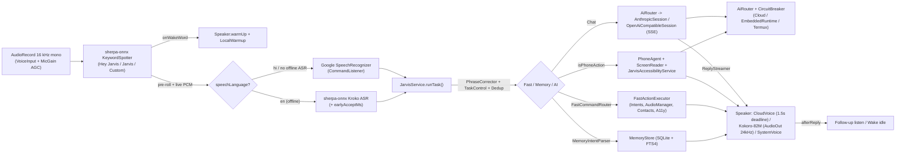
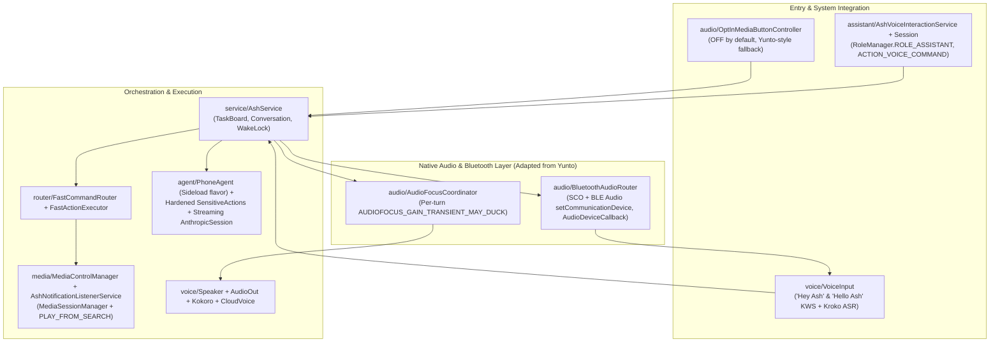

# Project Ash — Phase 1 Repository Audit & Technical Handoff

**Date:** 2026-11-23  
**Phase:** 1 — Repository Audit & Android Technical Research (Documentation Only; Zero Application Source Edits)  
**Target Workspace:** `/run/media/prabal/SANDISK E/Ash`

---

## 1. Executive Project Summary

Project Ash aims to build a native Kotlin Android AI voice assistant that responds to **"Hey Ash"** and **"Hello Ash"**, activates reliably (including screen-off operation wherever Android allows), integrates seamlessly with Bluetooth earbuds and headphones, routes spoken commands through supported microphones, places phone calls to contacts, controls music playback and music applications, opens and navigates Android apps, executes user-authorized phone automation, answers questions via selectable local or cloud AI models, resolves common commands deterministically offline in milliseconds, and delivers natural spoken responses while obeying Android permissions, privacy boundaries, lock-screen constraints, and platform policies.

This audit evaluates the two source repositories:

1. **`judejulius/jarvis` (Foundation Repository -> `/run/media/prabal/SANDISK E/Ash`)**: A mature, pure-Kotlin native Android assistant (`compileSdk = 35`, `targetSdk = 35`, `minSdk = 26`, 78 main `.kt` files, 39 unit test `.kt` files, MIT license). It already provides an end-to-end on-device speech stack (`sherpa-onnx` keyword spotting + Kroko streaming ASR + Kokoro-82M paced streaming TTS), cloud TTS fallbacks (OpenAI, ElevenLabs, Fish Audio, Custom), multi-provider LLM support (Anthropic official SDK + OpenAI-compatible SSE streaming), hybrid Auto/Online/Offline routing with circuit breaking, an embedded `llama-server` child-process runtime (plus Termux fallback), a bilingual English/Hinglish/Hindi fast deterministic command router (`router/`), contact resolution + calling (`contacts/`), `AccessibilityService`-based UI tree extraction & phone automation (`PhoneAgent`), SQLite+FTS4 memory & step-by-step task replay (`memory/` + `tasks/`), and a Dynamic Island overlay (`TaskIsland`).
2. **`lovisschmidt/yunto` (Reference Repository -> separate scratch clone)**: An Expo 54 / React Native 0.81.5 bring-your-own-key voice assistant (`MIT` license). Its JavaScript/Expo shell **must not** be merged into Ash, but its isolated native Android Kotlin module (`modules/headphone-button/android/src/main/java/expo/modules/headphonebutton/HeadphoneButtonModule.kt` and `HeadphoneButtonService.kt`, ~734 LOC total) plus its documented field findings (`docs/specs/2026-06-04-bluetooth-mic.md`, `docs/headset-compatibility.md`) solve real-world Android Bluetooth Classic HFP/SCO routing, `AudioDeviceCallback` disconnect classification, and dynamic Android 14+ foreground-service type elevation.

### Four Decisive Strategic Conclusions

1. **Jarvis Has Zero Bluetooth, Audio Focus, Default-Assistant, or Active Music-Session Control:** Jarvis contains no Bluetooth permissions, no `setCommunicationDevice()` / SCO / BLE Audio routing, no `AudioRecord.setPreferredDevice()`, no `AudioFocusRequest`, no `VoiceInteractionService` / `VoiceInteractionSession` / `RoleManager.ROLE_ASSISTANT`, and no `MediaSessionManager` music control (`dispatchMediaKeyEvent` is the only media primitive).
2. **Naive Porting of Yunto's `MediaSession` Pattern Will Break Music Apps & Loop Ash's Commands:** Yunto's `HeadphoneButtonService.claim()` registers an always-active `STATE_PLAYING` `MediaSession` and holds `AUDIOFOCUS_GAIN_TRANSIENT_MAY_DUCK` across idle listening. If copied verbatim into Ash, Ash would hijack earbud Play/Pause presses away from Spotify/YouTube Music, duck user music continuously, and intercept Jarvis's own `AudioManager.dispatchMediaKeyEvent()` commands. Ash must instead use **`VoiceInteractionService` + `RoleManager.ROLE_ASSISTANT` + `Intent.ACTION_VOICE_COMMAND`** for headset assistant triggers, keep Yunto-style `MediaSession` interception strictly off-by-default/opt-in, acquire audio focus **strictly per turn/utterance**, and control music apps via `NotificationListenerService` + `MediaSessionManager.getActiveSessions` + `MediaStore.INTENT_ACTION_MEDIA_PLAY_FROM_SEARCH`.
3. **Google Play vs. Sideload Distribution Fork:** Google Play's **Use of the AccessibilityService API** policy explicitly prohibits apps from using Accessibility APIs to *"autonomously initiate, plan, and execute actions or decisions"*, banning LLM-driven multi-step UI automation unless the app's exclusive core purpose is aiding users with disabilities (`isAccessibilityTool="true"`). Google Play also strictly polices `CALL_PHONE`, `REQUEST_IGNORE_BATTERY_OPTIMIZATIONS`, and Android 14+ foreground service declarations. Ash must structurally isolate Accessibility UI automation so a full-featured sideload build and a compliant Play Store flavor (if ever targeted) remain cleanly separable.
4. **Confirmed Critical Defects in Jarvis Must Be Fixed Early:** Jarvis currently ships 4 orphaned legacy files (`agent/FastCommandRouter.kt`, `agent/LocalServerManager.kt`, `memory/MemoryManager.kt`, `memory/JarvisDatabaseHelper.kt`) where `JarvisDatabaseHelper` declares SQLite `DATABASE_VERSION = 1` on the same `"jarvis_memory.db"` filename used by active `MemoryStore` at `DB_VERSION = 3`; `SensitiveActions` confirmation can be bypassed via `tap_point`, `long_press`, `type_text(press_enter = true)`, and non-English button labels; API keys live in plaintext `SharedPreferences`; `network_security_config.xml` allows global cleartext HTTP; `ModelDownloader` does not verify SHA-256 checksums; `AnthropicSession` does not support cancellation or streaming and hardcodes `maxTokens = 16000L`; and `BootReceiver` attempts to launch a `microphone` FGS from `BOOT_COMPLETED`, which Android 15 (API 35) forbids with `ForegroundServiceStartNotAllowedException`.

---

## 2. Exact Source Repositories and Inspected Revisions

| Role | Repository URL | Local Path | Branch | Exact Inspected Commit (HEAD) | Commit Timestamp & Author | License |
|---|---|---|---|---|---|---|
| **Primary Foundation (Ash)** | `https://github.com/judejulius/jarvis` (`origin`) | `/run/media/prabal/SANDISK E/Ash` | `master` | `5dd9934361317258bb1e35654fc5b33dcd861b7e` (`Translate the app into Hindi`) | `2026-11-23 11:55:13 +0200` — `judejulius` | MIT (`Copyright (c) 2026 Mohammad Joud Julius`) |
| **Reference Only (NOT merged)** | `https://github.com/lovisschmidt/yunto` (`origin`) | `/home/prabal/.gemini/antigravity-cli/brain/995b2dee-a253-4501-ac50-3fc51573108e/scratch/yunto` | `main` | `8bb110a6a11738601ae639dd4bd32eb446326f25` (`docs: add README hero, badges, and funding links (#32)`) | `2026-06-04 15:05:13 +0200` — `Lovis Schmidt` | MIT (`Copyright (c) 2026 Lovis Schmidt`) |

### Recent Commit Context

- **Jarvis latest commits before HEAD:**
  - `5dd9934` — Translate the app into Hindi
  - `a982e3f` — Give the model per-app tips
  - `b0d76e9` — Keep a task history with step-by-step replay
  - `27316ad` — Build Android APKs and model runtimes for ARM and x86_64
  - `cd6a8d9` — Add custom offline wake phrases
  - `59ac524` — Fall back to local speech when cloud audio takes too long
  - `4f0a98b` — Hear "Hey Jarvis" at a normal speaking volume
- **Yunto latest commits before HEAD:**
  - `8bb110a` — docs: add README hero, badges, and funding links (#32)
  - `db79cc1` — docs(claude): align with shipped prototype + document release versioning (#31)
  - `5b0f6b0` — fix(pipeline): only announce bluetooth drop while recording (#25)
  - `684a93c` — fix(session): roll stale session when a turn starts, not just on cold start (#24)

### Prior Documentation Check & Stale Upstream Claims

- **`docs/ash/` check:** Confirmed `docs/ash/` and `AGY_TASKS.md` did **not** exist in `/run/media/prabal/SANDISK E/Ash` prior to this Phase 1 audit.
- **Upstream docs cross-check:** Inspected `README.md`, `TODO.md`, `SECURITY.md`, `docs/ARCHITECTURE.md`, `docs/AUDIT.md`, and `docs/LIMITATIONS.md`. Upstream `docs/LIMITATIONS.md:21` still claims *"Calling or messaging a contact by name without the model (needs READ_CONTACTS); those requests go to the phone agent"* under Round 1 *"Not implemented"*, even though Round 2 subsequently implemented `contacts/` + `FastCommand.CallContact` + `FastActionExecutor.callContact()`. Similarly, `JarvisService.kt:738-739` retains a stale comment claiming wake-word detection is not restarted during model processing, although wake-word listening actually runs continuously unless `voice.stop()` or `voice.muted = true` is set.

### Host Environment Constraints & Artifacts Not Executed/Built in Phase 1

- **Filesystem:** `/run/media/prabal/SANDISK E/Ash` resides on **`vfat` (FAT32)** (`showexec`, case-insensitive, no Unix symlinks, no arbitrary executable bits). `./gradlew` therefore must be invoked via `bash ./gradlew`.
- **Java / Android SDK:** The host only has **OpenJDK 25.0.4** (`/usr/lib/jvm/java-25-openjdk-amd64`) and **no Android SDK** (`/home/prabal/Android/Sdk` and `/usr/lib/android-sdk` are absent; `adb`/`sdkmanager` are unavailable). `gradle-wrapper.properties` pins Gradle `8.11.1` (AGP `8.7.3`, Kotlin `2.0.21`), which does not support JDK 25 (CI uses Temurin JDK 21).
- **Unfetched binary artifacts (intentionally not downloaded in Phase 1):** `app/libs/sherpa-onnx-1.13.8.aar` (fetched on first Gradle build via `fetchSherpaOnnx`), `app/src/main/jniLibs/*/libllama_server.so` (built in CI via `scripts/build-llama-android.sh`), and `test-native/` Linux JNI/models. **Consequently, no Gradle build, lint pass, or unit test run was executed locally in Phase 1.**

---

## 3. Verified Source-Code Architecture

### 3.1 Jarvis Build, SDK, and Dependency Configuration

- **Project layout:** Single-module Gradle project (`settings.gradle.kts` includes only `:app`; `rootProject.name = "Jarvis"`).
- **Tooling versions (`build.gradle.kts`, `gradle/wrapper/gradle-wrapper.properties`, `app/build.gradle.kts`):**
  - Gradle `8.11.1`, Android Gradle Plugin `8.7.3`, Kotlin Android `2.0.21`
  - `namespace = "com.jarvis.assistant"`, `applicationId = "com.jarvis.assistant"`
  - `minSdk = 26`, `compileSdk = 35`, `targetSdk = 35`, `versionCode = 1`, `versionName = "0.1.0"`
  - `sourceCompatibility = JavaVersion.VERSION_17`, `targetCompatibility = JavaVersion.VERSION_17`, `jvmTarget = "17"`
  - `buildFeatures { viewBinding = true }`, `androidResources { generateLocaleConfig = true }`
  - `splits.abi`: `arm64-v8a`, `armeabi-v7a`, `x86_64` + `isUniversalApk = true`
  - `packaging.jniLibs`: excludes `**/x86/*.so`, sets `useLegacyPackaging = true` (extracts native binaries so `libllama_server.so` can be executed from `nativeLibraryDir`)
  - `buildTypes.release`: `isMinifyEnabled = false`
- **Dependencies (`app/build.gradle.kts:122-138`):**
  - `androidx.core:core-ktx:1.13.1`
  - `androidx.appcompat:appcompat:1.7.0`
  - `com.google.android.material:material:1.12.0`
  - `com.squareup.okhttp3:okhttp:4.12.0`
  - `com.anthropic:anthropic-java:2.34.0`
  - `org.apache.commons:commons-compress:1.27.1`
  - Local file AAR: `app/libs/sherpa-onnx-1.13.8.aar` downloaded on build via `fetchSherpaOnnx` task with pinned SHA-256 `633c24321e06b1fe79feafa03ea16cbc0f8a286641e2da3559bac91bdb13bd96`
  - Tests: `junit:4.13.2`, `org.robolectric:4.14.1`, `androidx.test:core:1.6.1`, `com.squareup.okhttp3:mockwebserver:4.12.0`

### 3.2 Jarvis Manifest, Permissions, and Components (`app/src/main/AndroidManifest.xml`)

- **Application:** `.JarvisApp` (`CrashReporter.kt:65-70`), `allowBackup="false"`, `networkSecurityConfig="@xml/network_security_config"`.
- **Activities:** `.ui.MainActivity` (exported `MAIN`/`LAUNCHER`, `singleTask`), `.ui.OnboardingActivity`, `.contacts.PermissionActivity` (translucent, `excludeFromRecents="true"`), `.memory.MemoryActivity`, `.ui.ModelEditActivity`.
- **Services:**
  - `.service.JarvisService` (`exported="false"`, `foregroundServiceType="microphone"`)
  - `.accessibility.JarvisAccessibilityService` (`exported="true"`, `BIND_ACCESSIBILITY_SERVICE`, configured by `res/xml/accessibility_service_config.xml`: `canPerformGestures="true"`, `canRetrieveWindowContent="true"`, `canTakeScreenshot="true"`)
- **Receiver:** `.service.BootReceiver` (`exported="true"`, `ACTION_BOOT_COMPLETED`).
- **Permissions (14):** `INTERNET`, `RECORD_AUDIO`, `FOREGROUND_SERVICE`, `FOREGROUND_SERVICE_MICROPHONE`, `POST_NOTIFICATIONS`, `RECEIVE_BOOT_COMPLETED`, `WAKE_LOCK`, `REQUEST_IGNORE_BATTERY_OPTIMIZATIONS`, `ACCESS_NETWORK_STATE`, `com.android.alarm.permission.SET_ALARM`, `com.termux.permission.RUN_COMMAND`, `READ_CONTACTS`, `CALL_PHONE`, `READ_PHONE_STATE`.
- **`<queries>`:** `com.termux`, `ACTION_MAIN/LAUNCHER`, `android.speech.RecognitionService`, `android.intent.action.TTS_SERVICE`.

### 3.3 Jarvis Runtime Pipeline (78 Main `.kt` Files)



Key architectural behaviors verified by source inspection:

1. **Foreground Service & Lifecycle (`service/JarvisService.kt`, 1129 LOC):**
   - `State` enum (`IDLE`, `LISTENING_COMMAND`, `WORKING`), cached thread pool (`jarvis-task`), `TaskBoard` tracking concurrent `INSTANT`, backgroundable `CHAT`, and exclusive `PHONE` (screen-locked via `uiLock: ReentrantLock(true)`) tasks.
   - Calls `ServiceCompat.startForeground(..., FOREGROUND_SERVICE_TYPE_MICROPHONE)` inside `onCreate()`, catching exceptions and calling `stopSelf()` if Android refuses FGS start.
   - `onTrimMemory(15)` unloads `Kokoro` (~200 MB) and stops `EmbeddedRuntime` (~1 GB).
   - `waitForUnlock()` (`JarvisService.kt:950-959`) wakes the screen using deprecated `PowerManager.SCREEN_BRIGHT_WAKE_LOCK or ACQUIRE_CAUSES_WAKEUP` and blocks up to 30 seconds polling `keyguard.isKeyguardLocked`.
   - Notification exposes *Talk* (`ACTION_LISTEN`), *Stop task* (`ACTION_STOP_TASK`), and *Turn off* (`ACTION_SHUTDOWN`).
2. **Audio Capture, Wake Word, Offline ASR & Barge-In (`voice/VoiceInput.kt`, 669 LOC):**
   - Single `jarvis-mic` thread guarded by an atomic `generation` counter (`alive(gen)`).
   - Uses `MediaRecorder.AudioSource.VOICE_RECOGNITION` while idle (to avoid carrier/AGC suppression) and restarts into `VOICE_COMMUNICATION` + `AcousticEchoCanceler` only while `wantsEchoCancellation()` is active (within `ECHO_HOLD_MS = 1200ms` of Jarvis speaking).
   - `MicGain` (`MicGain.kt`, 76 LOC) applies adaptive soft-limited gain up to `32x` capped against learned room `noiseFloor` (`MAX_NOISE_AFTER_GAIN = 0.01f`).
   - Feeds 16 kHz PCM into `KeywordSpotter` (GigaSpeech 3.3M int8 Zipformer) and maintains a 1.5s `recent` ring buffer (`15 x 100ms`) so one-breath utterances (*"Hey Jarvis, turn on the flashlight"*) replay seamlessly into `OnlineRecognizer` (Kroko Zipformer).
   - Barge-in (`checkBargeIn`) runs a parallel `STOP_KEYWORD` spotter (disabled via `soundsLikeStop()` if Jarvis's own sentence contains `st[aeiouy]*`/`top*`) and a full ASR echo comparator (`isBargeIn`).
   - Includes a digital-silence watchdog (`SILENT_READS = 50`, 5 seconds of all-zero PCM samples triggers `MicExit.BLOCKED`, capped at `MAX_BLOCKED_RESTARTS = 2`).
3. **Speech Synthesis (`voice/Voice.kt`, `Kokoro.kt`, `CloudVoice.kt`, `SystemVoice.kt`, `AudioOut.kt`, `SentenceChunker.kt`, `SpeechChunks.kt`, `SpeechPacer.kt`, `Cpu.kt`):**
   - `AudioOut` owns a singleton 24 kHz `ENCODING_PCM_FLOAT` `AudioTrack` (`USAGE_ASSISTANT`, `CONTENT_TYPE_SPEECH`, `setStartThresholdInFrames(256)` on API 31+) with ticket-based interruption and 20 ms RMS envelope tracking for the `TaskIsland` visualizer.
   - `Kokoro` streams paced chunks (`FIRST_PIECE = 40` chars, `SpeechPacer` adapts to measured `realTimeFactor` on `VOICE_THREADS` fast cores) and pre-renders `STOCK_PHRASES` + `Persona` greetings/acks onto `cacheDir/kokoro-phrases/*.pcm`.
   - `CloudVoice` streams raw 24 kHz PCM from OpenAI, ElevenLabs, Fish Audio, or custom OpenAI-compatible endpoints, canceling and falling back locally if no 2-byte sample arrives within `FIRST_AUDIO_TIMEOUT_MS = 1500L`.
   - `ReplyStreamer` + `SentenceChunker` stream `OpenAiCompatibleSession` chat deltas sentence-by-sentence and pre-synthesize sentence `N+1` via `Kokoro.prepare()` while sentence `N` plays.
4. **Local Command Router (`router/`, `apps/`, `contacts/`):**
   - `Lexicon.normalize()` transliterates Devanagari words/digits and strips filler phrases (`"hey"`, `"jarvis"`, etc.), then `PhraseCorrector` applies user-taught spoken corrections, then `MemoryIntentParser` and `FastCommandRouter.parse()` (max 12 words) match deterministic commands, and `FastActionExecutor` executes and verifies outcomes (e.g., `waitForForeground`, `TorchCallback`, `AudioManager.isMusicActive`, `TelecomManager.isInCall`).
   - `ContactMatcher` handles English + Devanagari transliteration (`Translit`) + kin groups (`mom`/`mummy`/`ammi`, `dad`/`papa`, etc.) + multi-candidate disambiguation via `host.ask()`.
5. **AI Routing, Local Runtime & Phone Agent (`ai/`, `runtime/`, `agent/`):**
   - `AiRouter` combines `builtin-on-device-qwen` (`EmbeddedRuntime`) + user `ModelProfile`s, orders them via `RoutePolicy` (`AUTO` prefers local only for <=14-word non-Hindi non-current-info non-complex chat, and prefers cloud for `TaskKind.AGENT` when online), and demotes failing providers via `CircuitBreaker` (30s–300s exponential backoff).
   - `EmbeddedRuntime` executes `libllama_server.so` from `nativeLibraryDir` on `127.0.0.1:18080` with a random 48-hex `--api-key`, `-c 4096`, `-np 1`, `--cache-ram 512`, `RuntimePolicy` 15s watchdog, and `GgufDownloader` (HTTPS-only redirects, `Range` resume, GGUF magic check, Hugging Face `X-Linked-ETag` SHA-256 verification).
   - `PhoneAgent` runs up to `settings.maxSteps` (default 40) observe-think-act loops using `JarvisAccessibilityService` + `ScreenReader` (300 elements cloud / 80 compact local) + `AppTips` + `SensitiveActions` confirmation gate.
6. **Legacy Dead Code Verified Unused (`agent/FastCommandRouter.kt`, `agent/LocalServerManager.kt`, `memory/MemoryManager.kt`, `memory/JarvisDatabaseHelper.kt`):**
   - `grep` across `app/src/main/` confirms zero production call sites reference these 4 classes (`JarvisService`, `AssistantSection`, `FastActionExecutor`, `MemoryStore` all use the newer `router/` and `ai/` and `MemoryStore` replacements). Only `app/src/test/.../MemoryManagerTest.kt` (and `agent/FastCommandRouterTest.kt`, `agent/LocalServerManagerTest.kt`) exercise them.

### 3.4 Yunto Native Architecture (`modules/headphone-button/android/`)

Yunto (`lovisschmidt/yunto`) is an Expo 54 / React Native 0.81.5 app (`package.json`) whose JS pipeline (`src/services/pipeline.ts`) records audio via `expo-audio`, sends recordings to OpenAI Whisper, streams Claude tool-calls, and pipes ElevenLabs PCM chunks back through a native Android Expo module:

- **`HeadphoneButtonModule.kt` (305 LOC):**
  - `getInputState()`: Queries `AudioManager.getDevices(AudioManager.GET_DEVICES_INPUTS)` for `TYPE_BUILTIN_MIC` and `TYPE_BLUETOOTH_SCO` (gated on `Build.VERSION.SDK_INT >= Build.VERSION_CODES.Q`).
  - `connectBluetoothSco(timeoutMs)`: Switches `am.mode = AudioManager.MODE_IN_COMMUNICATION`; on API 31+ (`S`) selects the first `TYPE_BLUETOOTH_SCO` from `availableCommunicationDevices`, calls `setCommunicationDevice()`, and waits `SCO_SETTLE_MS = 300L`; on API 29–30 calls deprecated `startBluetoothSco()` and waits on `ACTION_SCO_AUDIO_STATE_UPDATED`. Every timeout/failure invokes `teardownSco()`.
  - `teardownSco()`: Sets `expectingTeardown = true`, clears `setCommunicationDevice`/`stopBluetoothSco`, restores `MODE_NORMAL`, and resets `expectingTeardown = false` after 1500 ms.
  - `AudioDeviceCallback`: Differentiates full BT headset disappearance (any `TYPE_BLUETOOTH_A2DP` or `TYPE_BLE_HEADSET` removed -> emits `"disconnected"`) vs SCO-only drop while output remains connected (hang-up -> emits `"stop"`).
- **`HeadphoneButtonService.kt` (429 LOC):**
  - Foreground service (`START_STICKY`, `foregroundServiceType="mediaPlayback|microphone"`). Dynamically omits `FOREGROUND_SERVICE_TYPE_MICROPHONE` until `RECORD_AUDIO` permission is granted (`refreshForegroundServiceType()` re-applies `startForeground`).
  - `MediaSession` (`"YuntoHeadphoneButton"`) intercepts `KEYCODE_MEDIA_PLAY_PAUSE`, `KEYCODE_HEADSETHOOK`, `KEYCODE_MEDIA_PLAY`, `KEYCODE_MEDIA_PAUSE` with 300 ms single/double-press debounce, plus `KEYCODE_MEDIA_NEXT` -> `"double"`.
  - `requestAudioFocus()` acquires `AUDIOFOCUS_GAIN_TRANSIENT_MAY_DUCK` when `claim()` runs, and stops TTS playback on `AUDIOFOCUS_LOSS` / `AUDIOFOCUS_LOSS_TRANSIENT`.
  - Streams Base64 PCM onto an `AudioTrack` (`USAGE_MEDIA`, `CONTENT_TYPE_SPEECH`) via a `LinkedBlockingQueue` writer thread.

---

## 4. Relevant Actual File Paths

### 4.1 Project Ash / Jarvis Workspace (`/run/media/prabal/SANDISK E/Ash/`)

- **Build & Config:** `build.gradle.kts`, `settings.gradle.kts`, `gradle.properties`, `gradle/wrapper/gradle-wrapper.properties`, `app/build.gradle.kts`, `LICENSE`, `README.md`, `TODO.md`, `SECURITY.md`
- **Manifest & XML:** `app/src/main/AndroidManifest.xml`, `app/src/main/res/xml/accessibility_service_config.xml`, `app/src/main/res/xml/network_security_config.xml`, `app/src/main/res/values/strings.xml`, `app/src/main/res/values-hi/strings.xml`, `app/src/main/assets/wake-pieces.txt`
- **App & Service:** `app/src/main/java/com/jarvis/assistant/CrashReporter.kt` (contains `JarvisApp`), `Settings.kt`, `service/JarvisService.kt`, `service/BootReceiver.kt`
- **Voice, ASR & TTS:** `voice/VoiceInput.kt`, `voice/WakePhrase.kt`, `voice/CommandListener.kt`, `voice/MicGain.kt`, `voice/ModelDownloader.kt`, `voice/Voice.kt`, `voice/Kokoro.kt`, `voice/CloudVoice.kt`, `voice/SystemVoice.kt`, `voice/AudioOut.kt`, `voice/SentenceChunker.kt`, `voice/SpeechChunks.kt`, `voice/SpeechPacer.kt`, `voice/Cpu.kt`
- **Fast Router, Contacts & Apps:** `router/Commands.kt`, `router/FastCommandRouter.kt`, `router/FastActionExecutor.kt`, `router/AppMatcher.kt`, `router/Lexicon.kt`, `router/MemoryIntentParser.kt`, `router/PhraseCorrector.kt`, `apps/AppActions.kt`, `contacts/ContactMatcher.kt`, `contacts/ContactResolver.kt`, `contacts/PermissionActivity.kt`
- **AI, Agent & Local Runtime:** `ai/AiMode.kt`, `ai/AiRouter.kt`, `ai/RoutePolicy.kt`, `ai/ModelGate.kt`, `ai/LocalServerManager.kt`, `ai/LocalWarmup.kt`, `ai/ServerHealth.kt`, `ai/Endpoints.kt`, `ai/Connectivity.kt`, `runtime/EmbeddedRuntime.kt`, `runtime/GgufDownloader.kt`, `runtime/RuntimeConfig.kt`, `agent/PhoneAgent.kt`, `agent/Llm.kt`, `agent/AnthropicSession.kt`, `agent/OpenAiCompatibleSession.kt`, `agent/SseParser.kt`, `agent/JsonUtil.kt`, `agent/SensitiveActions.kt`, `agent/AppTips.kt`
- **Accessibility:** `accessibility/JarvisAccessibilityService.kt`, `accessibility/ScreenReader.kt`
- **Memory, Tasks & Persona:** `memory/MemoryStore.kt`, `memory/MemoryCore.kt`, `memory/MemoryLabels.kt`, `memory/MemoryActivity.kt`, `memory/SensitiveFilter.kt`, `memory/TaskReplayDialog.kt`, `tasks/TaskBoard.kt`, `tasks/TaskHistory.kt`, `persona/Persona.kt`, `util/LatencyTrace.kt`
- **Dead Legacy Duplicates (Unused in Production):** `agent/FastCommandRouter.kt`, `agent/LocalServerManager.kt`, `memory/MemoryManager.kt`, `memory/JarvisDatabaseHelper.kt`
- **UI:** `ui/MainActivity.kt`, `ui/OnboardingActivity.kt`, `ui/HomeFragment.kt`, `ui/ModelsFragment.kt`, `ui/ModelEditActivity.kt`, `ui/SettingsFragment.kt`, `ui/AssistantSection.kt`, `ui/Setup.kt`, `ui/TaskIsland.kt`, `ui/ArcReactorView.kt`, `ui/IslandViews.kt`, `ui/Insets.kt`, `ui/UiKit.kt`
- **Tests (39 files):** `app/src/test/java/com/jarvis/assistant/CrashSafetyTest.kt`, `RealEngineTest.kt`, `RealEngineTestTuning.kt`, `TurnOffTest.kt`, `agent/{AppTipsTest,FastCommandRouterTest,LocalServerManagerTest,SensitiveActionsTest}.kt`, `ai/{RoutePolicyTest,ServerHealthTest}.kt`, `apps/YouTubeActionTest.kt`, `contacts/ContactMatcherTest.kt`, `memory/{MemoryCoreTest,MemoryLabelsTest,MemoryManagerTest,MemoryStoreTest}.kt`, `persona/PersonaTest.kt`, `router/{AppMatcherTest,FastCommandRouterTest,MemoryIntentParserTest,PhraseCorrectorTest}.kt`, `runtime/{GgufDownloaderTest,RuntimeConfigTest}.kt`, `tasks/TaskBoardTest.kt`, `ui/{AppFlowTest,BackgroundStepTest,LayoutSafetyTest,ScreenshotTest,TaskIslandTest,TaskReplayTest}.kt`, `util/LatencyTraceTest.kt`, `voice/{CleanTranscriptTest,CloudVoiceTest,CpuTest,MicGainTest,ModelDownloaderTest,SentenceChunkerTest,SpeechChunksTest,SpeechPacerTest}.kt`
- **CI, Scripts & Docs:** `.github/workflows/ci.yml`, `.github/workflows/release.yml`, `scripts/build-llama-android.sh`, `scripts/check-apk-abis.py`, `termux/{install-termux,llama-supervisor,start-llama,status}.sh`, `docs/{ARCHITECTURE,AUDIT,INSTALL,LIMITATIONS,VERIFICATION}.md`, `claude-delivery/`

### 4.2 Reference Repository Yunto (`.../scratch/yunto/`)

- **Native Kotlin Module:** `modules/headphone-button/android/src/main/java/expo/modules/headphonebutton/HeadphoneButtonModule.kt`, `HeadphoneButtonService.kt`
- **Module Manifest & Gradle:** `modules/headphone-button/android/src/main/AndroidManifest.xml`, `modules/headphone-button/android/build.gradle`, `modules/headphone-button/expo-module.config.json`, `modules/headphone-button/src/HeadphoneButtonModule.ts`, `HeadphoneButton.types.ts`
- **App Shell & JS Pipeline:** `android/build.gradle`, `android/app/build.gradle`, `android/app/src/main/AndroidManifest.xml`, `package.json`, `src/services/pipeline.ts`
- **Reference Docs & License:** `LICENSE`, `docs/headset-compatibility.md`, `docs/troubleshooting.md`, `docs/specs/2026-06-04-bluetooth-mic.md`

---

## 5. Features Already Implemented (in Jarvis Foundation)

| Capability | Verified Implementation | Current Status / Caveats |
|---|---|---|
| **Offline Wake Word** | `VoiceInput.kt` + `WakePhrase.kt` + `wake-pieces.txt` (`sherpa-onnx` GigaSpeech 3.3M int8) | Hardcoded `"Hey Jarvis"` / `"Jarvis"`; 1 custom phrase alongside Jarvis; 1.5s pre-roll replay |
| **Offline + Fallback ASR** | `VoiceInput.kt` (Kroko Zipformer) + `CommandListener.kt` (`SpeechRecognizer` `hi-IN`) | English-only offline; Google fallback disables continuous follow-up & requires Google app |
| **Echo-Aware Barge-In & Follow-Up** | `VoiceInput.checkBargeIn()` + `STOP` keyword + `JarvisService.afterReply()` | Works via `VOICE_COMMUNICATION` + `AcousticEchoCanceler` + transcript echo stripping |
| **On-Device & Cloud TTS** | `Kokoro.kt` (Kokoro-82M int8, `SpeechPacer`, `ReplyStreamer`, disk cache) + `CloudVoice.kt` + `SystemVoice.kt` | 1.5s cloud deadline fallback; no `AudioFocusRequest` |
| **Selectable AI Models & Routing** | `Settings.kt`, `AiRouter.kt`, `RoutePolicy.kt`, `AnthropicSession.kt`, `OpenAiCompatibleSession.kt` | Supports Anthropic, OpenAI, LM Studio, Ollama, OpenRouter, Gemini, Groq, Custom; `AnthropicSession` lacks cancel & stream |
| **Embedded On-Device LLM** | `EmbeddedRuntime.kt` + `GgufDownloader.kt` + `RuntimeConfig.kt` + `LocalWarmup.kt` | Downloads `Qwen2.5-1.5B-Instruct-Q4_K_M.gguf` (~1 GB); `libllama_server.so` built in CI; Termux fallback exists |
| **Deterministic Fast Router** | `router/FastCommandRouter.kt` + `FastActionExecutor.kt` + `Lexicon.kt` + `AppMatcher.kt` | Apps, nav keys, scroll, volume, torch, alarms/timers, settings, YouTube search+tap, basic media keys, time/date/battery |
| **Contacts & Phone Calling** | `contacts/ContactMatcher.kt` + `ContactResolver.kt` + `PermissionActivity.kt` + `FastActionExecutor.callContact()` | Disambiguation, `confirmSensitive`, `ACTION_CALL` / `ACTION_DIAL`, `TelecomManager.isInCall` verification; blocked behind lock screen |
| **Phone Automation (A11y)** | `JarvisAccessibilityService.kt`, `ScreenReader.kt`, `PhoneAgent.kt`, `AppTips.kt`, `SensitiveActions.kt` | Reads 300/80 UI nodes + `takeScreenshot` (API 30+); `SensitiveActions` has confirmed bypasses |
| **Memory & Task Replay** | `MemoryStore.kt` (SQLite v3 + FTS4), `SensitiveFilter.kt`, `TaskBoard.kt`, `TaskHistory.kt` | App aliases, phrase corrections, notes, 100-task replay log; cloud memory sharing opt-in |
| **UI, Dynamic Island & Crash Safety** | `MainActivity`, `OnboardingActivity`, `TaskIsland`, `CrashReporter` (`ApplicationExitInfo`) | Full Material 3 views, English + Hindi localization, 39 unit test files |

---

## 6. Missing Ash Requirements

1. **Wake Phrases `"Hey Ash"` and `"Hello Ash"`:**
   - Verified directly against `app/src/main/assets/wake-pieces.txt` (497 SentencePiece unigram tokens): both target phrases tokenize cleanly with zero missing pieces:
     - `"Hey Ash"` -> `▁HE Y ▁A SH`
     - `"Hello Ash"` -> `▁HE LL O ▁A SH`
     - (`"Ash"` -> `▁A SH` — **do NOT enable bare `"Ash"`** as a standalone keyword due to inevitable false triggers on `"cash"`, `"flash"`, `"trash"`, `"wash"`, `"ask"`.)
   - Currently `WakeModel.KEYWORDS` hardcodes `Hey Jarvis` / `Jarvis`, `VoiceInput.clean()` hardcodes `"jarvis"` fuzzy stripping, `Lexicon.LEADING` drops `"jarvis"`, `FastCommandRouter.TYPE_RAW` strips `"hey jarvis"`, `MemoryIntentParser.GREETING` strips `"jarvis"`, and `grep` finds **604** case-insensitive `"jarvis"` occurrences across `app/src/main/`.
2. **Default Assistant Registration (`VoiceInteractionService` / `RoleManager`):**
   - Missing `VoiceInteractionService`, `VoiceInteractionSessionService`, `VoiceInteractionSession`, `res/xml/voice_interaction_service.xml`, `BIND_VOICE_INTERACTION` manifest entry, `RoleManager.ROLE_ASSISTANT` onboarding prompt, and `Intent.ACTION_VOICE_COMMAND` / `Intent.ACTION_ASSIST` entry points.
3. **Screen-Off Reliability & Android 15+ Boot Restrictions:**
   - Without `VoiceInteractionService`, Ash lacks Android 12–17 background FGS start and WIU microphone exemptions.
   - `BootReceiver.kt:14` blindly calls `JarvisService.startIfSwitchedOn(context)` on `BOOT_COMPLETED`, which **throws `ForegroundServiceStartNotAllowedException`** for `microphone` FGS on Android 15+ (API 35).
   - No `PARTIAL_WAKE_LOCK` protects multi-second command turnaround (ASR -> LLM -> TTS) against CPU sleep when the screen is off.
4. **Bluetooth Earbuds & Headphones Support:**
   - Missing `BLUETOOTH_CONNECT`, `BLUETOOTH` (`maxSdkVersion="30"`), `MODIFY_AUDIO_SETTINGS`.
   - Missing `AudioDeviceCallback`, `setCommunicationDevice()` (`TYPE_BLUETOOTH_SCO` & `TYPE_BLE_HEADSET`), API < 31 `startBluetoothSco()` fallback, `AudioRecord.setPreferredDevice()`, SCO->A2DP teardown/settle before TTS playback, disconnect abort/fallback handling, and Bluetooth HFP long-press assistant invocation.
5. **Audio Focus Management:**
   - `AudioOut.kt`, `Speaker`, and `JarvisService` **never request or abandon audio focus**. This causes Ash to speak over music/podcasts/navigation and violates **Android 17 (API 37) background audio hardening**, where background audio playback and focus requests fail silently or return `AUDIOFOCUS_REQUEST_FAILED` without a WIU-capable FGS.
6. **Music Playback & Music App Control:**
   - `FastCommandRouter.media()` (`FastCommandRouter.kt:197-208`) requires a word from `MUSIC_WORDS` (`music`, `song`, `gaana`, ...) for play/pause, rejecting bare `"pause"`, `"resume"`, `"stop music"` edge cases, `"play <song>"`, `"play <artist> on Spotify"`, etc.
   - `FastActionExecutor.media()` (`FastActionExecutor.kt:252-276`) only calls `AudioManager.dispatchMediaKeyEvent()`, which cannot target a specific player, cannot query current track/state accurately, cannot search-and-play in Spotify/YouTube Music, and will self-trigger Ash if Ash ever holds an active `MediaSession`.
7. **Lock-Screen Hands-Free Calling:**
   - `JarvisService.needsUnlock()` (`JarvisService.kt:783-789`) treats `FastCommand.CallContact` and `FastCommand.Dial` as requiring `waitForUnlock()`, forcing the user to unlock their screen even for hands-free headset calling (though Android itself still gates `CALL_PHONE` / lock-screen security by device policy).
   - No explicit emergency-number routing guard (`ACTION_DIAL` for emergency numbers per Telecom guidance) and no audio-route awareness (speakerphone vs BT headset during calls).
8. **Security, Agent Safety & Distribution Hygiene:**
   - See Sections 9 and 10 (`SensitiveActions` bypasses, plaintext keys, global cleartext HTTP, unverified model downloads, `AnthropicSession` cancellation/streaming, `JarvisDatabaseHelper` v1 conflict, Google Play Accessibility policy isolation).

---

## 7. Yunto Components Suitable for Adaptation (Native Kotlin Only)

**Strict Rule:** Extract and rewrite **only** native Android Kotlin logic from `modules/headphone-button/android/`. **Never** introduce React Native, Expo, `expo-modules-core`, `expo-audio`, `expo-speech`, or `expo-secure-store` into Ash. Preserve MIT copyright attribution (`Copyright (c) 2026 Lovis Schmidt`) in `THIRD_PARTY_NOTICES.md` / file headers where adapted.

| Yunto Source (`modules/headphone-button/...`) | Verdict | How to Adapt Safely for Project Ash |
|---|---|---|
| **SCO Routing State Machine** (`HeadphoneButtonModule.kt:145-247`) | **ADAPT** | Extract into pure native `BluetoothAudioRouter`: `MODE_IN_COMMUNICATION`, `setCommunicationDevice` (API 31+) / `startBluetoothSco` (API 26–30, extending Yunto's API 29 floor), `AudioRecord.setPreferredDevice()`, timeout cleanup restoring `MODE_NORMAL`, and **add `TYPE_BLE_HEADSET` support** + `BLUETOOTH_CONNECT` check. |
| **`AudioDeviceCallback` Drop Classifier** (`HeadphoneButtonModule.kt:249-304`) | **ADAPT** | Keep the exact distinction: BT output (`TYPE_BLUETOOTH_A2DP` / `TYPE_BLE_HEADSET`) gone = full headset disconnect -> fallback to phone mic; SCO input gone while BT output remains = user hung up / headset closed SCO. |
| **Dynamic FGS Type Promotion** (`HeadphoneButtonService.kt:73-88, 424-427`) | **ADAPT** | Only attach `FOREGROUND_SERVICE_TYPE_MICROPHONE` when `RECORD_AUDIO` is granted; re-apply `startForeground` immediately after onboarding permission grant without crashing. |
| **`AudioFocusRequest` + Loss Listener** (`HeadphoneButtonService.kt:45-54, 235-264`) | **ADAPT (FIX)** | Reuse `AUDIOFOCUS_GAIN_TRANSIENT_MAY_DUCK` + `OnAudioFocusChangeListener`, **but acquire only per active listening/TTS turn and abandon immediately when idle**. |
| **Spoken BT Fallback / Disconnect UX** (`src/services/pipeline.ts:163-185, 294-302`) | **ADAPT CONCEPT** | Speak fallback cue (*"Using phone microphone"*) only when BT mic fails to connect; speak disconnect notice only if actively recording a command. |
| **`MediaSession` Button Grabber** (`HeadphoneButtonService.kt:110-127, 266-332`) | **OPT-IN ONLY** | **Off by default.** Only enable if user toggles a compatibility setting for headsets that lack `ACTION_VOICE_COMMAND` long-press, and never hold `STATE_PLAYING` when music apps should own media buttons. |
| **Base64 PCM Queue + `AudioTrack` (`USAGE_MEDIA`)** (`HeadphoneButtonService.kt:131-233`) | **REJECT** | Jarvis's `AudioOut.kt` (24 kHz float stream, `USAGE_ASSISTANT`, `setStartThresholdInFrames`, RMS envelope) is already strictly superior. |
| **Deliberate-Mute `-160 dBFS` Stop Detector** (`src/services/pipeline.ts:188-221`) | **REJECT (Default)** | Causes false cut-offs on DTX/comfort-noise headsets; Ash already has continuous streaming ASR endpointing + `earlyAccept` + barge-in. |
| **Expo / RN Wrapper & External Storage Perms** (`android/app/src/main/AndroidManifest.xml:7,9`) | **REJECT** | Never introduce Expo/RN or `READ_EXTERNAL_STORAGE`/`WRITE_EXTERNAL_STORAGE`. |

### Confirmed Yunto Bugs NOT to Port to Ash

1. **`connectSco()` & `getInputState()` ignore `TYPE_BLE_HEADSET`** (`HeadphoneButtonModule.kt:107, 169`) even though `isBtOutput()` checks it (`:304`).
2. **`connectSco()` returns `false` below API 29** (`:147`), needlessly blocking Android 8.0–9.0 (`minSdk 26`).
3. **Untracked `Handler.postDelayed` timers** (`:178` 300 ms resolve, `:246` 1500 ms `expectingTeardown = false`) are never canceled on rapid reconnects/teardown, allowing stale callbacks to corrupt a new turn.
4. **Permanent `AUDIOFOCUS_GAIN_TRANSIENT_MAY_DUCK` during idle** (`HeadphoneButtonService.kt:112, 239`) ducks music whenever the service is listening for buttons.
5. **Missing `BLUETOOTH_CONNECT` runtime permission guard** inside `HeadphoneButtonModule.kt` before reading device info / routing.

---

## 8. Android Compatibility and Restrictions (Android 12–17 / API 31–37)

| Topic | Verified Platform Behavior & API Rules | Concrete Impact on Project Ash | Official Documentation |
|---|---|---|---|
| **1. `VoiceInteractionService` & Default Assistant** | Registered via `BIND_VOICE_INTERACTION` + `@xml/voice_interaction_service` + supplementary `RecognitionService`. User assigns `RoleManager.ROLE_ASSISTANT`. Grants system binding (`BFGS`) and background FGS start exemption. | Primary mechanism for Ash to receive Bluetooth HFP voice button (`ACTION_VOICE_COMMAND`), gesture triggers, and reliable background/screen-off operation. | [VoiceInteractionService](https://developer.android.com/reference/android/service/voice/VoiceInteractionService), [RoleManager](https://developer.android.com/reference/android/app/role/RoleManager) |
| **2. `VoiceInteractionSession`** | `VoiceInteractionSessionService` spawns `VoiceInteractionSession` overlay UI on assistant invocation; supports `android:supportsAssist` and `android:supportsLaunchVoiceAssistFromKeyguard`. | Enables clean assistant overlay even over keyguard without launching a full Activity. | [VoiceInteractionSession](https://developer.android.com/reference/android/service/voice/VoiceInteractionSession) |
| **3. Software vs. Hardware Wake-Word** | `AlwaysOnHotwordDetector` + `HotwordDetectionService` interface with DSP/SoundTrigger HAL via `CAPTURE_AUDIO_HOTWORD` and `MANAGE_VOICE_KEYPHRASES` — both are **`signature|privileged` system permissions** and DSP keyphrases are firmware/OEM enrolled. | **Third-party apps CANNOT use hardware hotword detection for arbitrary custom phrases like `"Hey Ash"` / `"Hello Ash"`.** Ash must keep software `sherpa-onnx` KWS on `AudioRecord` inside a foreground service (or `VoiceInteractionService`). | [AlwaysOnHotwordDetector](https://developer.android.com/reference/android/service/voice/AlwaysOnHotwordDetector), [HotwordDetectionService](https://developer.android.com/reference/android/service/voice/HotwordDetectionService) |
| **4. Android 12–17 Background & FGS Timeline** | **API 31:** Background FGS starts throw `ForegroundServiceStartNotAllowedException` (explicit exemption for apps providing `VoiceInteractionService`). **API 33:** `POST_NOTIFICATIONS` + sideload Restricted Settings. **API 34:** Mandatory `foregroundServiceType` + while-in-use (WIU) enforcement for `microphone`. **API 35:** `BOOT_COMPLETED` **banned** from starting `microphone`/`mediaPlayback`/`phoneCall` FGS; `SYSTEM_ALERT_WINDOW` FGS exemption requires visible overlay; `dataSync`/`mediaProcessing` 6h caps. **API 36:** FGS jobs subject to regular/expedited quotas; `setImportantWhileForeground` ignored. **API 37:** Background audio hardening requires visible Activity or WIU-capable FGS for playback/focus/volume (else silent fail / `AUDIOFOCUS_REQUEST_FAILED`). | Remove `microphone` FGS launch from `BootReceiver` on API 35+; add `VoiceInteractionService` for assistant exemption; enforce `AudioFocusRequest` + WIU-capable FGS for Android 17 readiness. | [BG FGS Restrictions](https://developer.android.com/develop/background-work/services/fgs/restrictions-bg-start), [FGS Types](https://developer.android.com/develop/background-work/services/fgs/service-types), [Android 15](https://developer.android.com/about/versions/15/behavior-changes-15), [Android 16](https://developer.android.com/about/versions/16/behavior-changes-16), [Android 17](https://developer.android.com/about/versions/17/behavior-changes-all) |
| **5. Microphone FGS & Input Sharing** | Requires `FOREGROUND_SERVICE_MICROPHONE` + granted `RECORD_AUDIO` + notification. Under concurrent audio sharing: `VoiceInteractionService` (with `ROLE_ASSISTANT`) outranks ordinary apps, but `VOICE_COMMUNICATION` (phone/VoIP calls) and foreground UI capture still silence background listeners. | Ash's wake-word `AudioRecord` will be silenced during phone calls/voice memos; `VoiceInput`'s blocked-mic detector must recognize active phone calls (`TelecomManager.isInCall`) instead of aggressively reopening the mic 3x while in a call. | [Sharing Audio Input](https://developer.android.com/guide/topics/media/sharing-audio-input) |
| **6. Screen-Off, Doze & OEM Battery Policies** | Doze defers jobs/network and ignores standard wake locks unless an active FGS runs. `AudioRecord` holds internal `AudioIn` wakelock while streaming, but CPU work between capture and TTS can sleep without scoped `PARTIAL_WAKE_LOCK`. OEMs (Realme/ColorOS, Xiaomi MIUI/HyperOS, Samsung One UI) still kill FGSs aggressively. | Keep continuous wake-word listening strictly opt-in with transparent battery warnings; acquire ref-counted `PARTIAL_WAKE_LOCK` only during active command turnaround; retain `VoiceInteractionService` + headset button as low-power fallback. | [Doze & App Standby](https://developer.android.com/training/monitoring-device-state/doze-standby) |
| **7. Bluetooth Classic vs. BLE Audio** | `startBluetoothSco`/`stopBluetoothSco`/`setSpeakerphoneOn` deprecated in API 31 in favor of `AudioManager.setCommunicationDevice(AudioDeviceInfo)` + `clearCommunicationDevice()` + `AudioDeviceCallback`. Classic HFP/SCO runs narrowband/wideband mono (8/16 kHz) and locks out A2DP hi-fi during capture; BLE Audio (LC3) supports up to 32 kHz mic + simultaneous hi-fi audio; Android 16 adds hearing-aid LEA mic switching + `ACTION_KEY_MISSING` bond-loss intent. | Prefer `TYPE_BLE_HEADSET` when available (avoiding SCO->A2DP teardown latency where supported); use `setCommunicationDevice` on API 31+ for both `TYPE_BLUETOOTH_SCO` and `TYPE_BLE_HEADSET`, with API 26–30 SCO fallback. Guard all BT APIs with `BLUETOOTH_CONNECT` on API 31+. | [Self-managed AudioManager](https://developer.android.com/develop/connectivity/telecom/selfManaged#audio-manager), [setCommunicationDevice](https://developer.android.com/reference/android/media/AudioManager#setCommunicationDevice(android.media.AudioDeviceInfo)) |
| **8. MediaSession & Media-Button Routing** | Media keys (`KEYCODE_MEDIA_PLAY_PAUSE`, `KEYCODE_HEADSETHOOK`) route to the last active `MediaSession` (music app). Long-press assistant / `KEYCODE_VOICE_ASSIST` / HFP `AT+BVRA` dispatches `Intent.ACTION_VOICE_COMMAND` to `ROLE_ASSISTANT`. `MediaSessionManager.getActiveSessions(componentName)` requires user-enabled `NotificationListenerService` (or system `MEDIA_CONTENT_CONTROL`). | Never register a permanent `STATE_PLAYING` `MediaSession` by default; implement `NotificationListenerService` to read/control active players cleanly. | [MediaSessionManager](https://developer.android.com/reference/android/media/session/MediaSessionManager) |
| **9. Contact & Calling APIs** | `READ_CONTACTS` + `CALL_PHONE` (or permissionless `ACTION_DIAL`) + `READ_PHONE_STATE` (`TelecomManager.isInCall`). Non-system apps calling emergency numbers via `ACTION_CALL` are redirected to the preloaded dialer. Keyguard blocks UI-dependent actions unless `showWhenLocked` / unlock occurs. | Allow confirmed hands-free `ACTION_CALL` without forcing UI unlock where telecom permits; fall back cleanly to `ACTION_DIAL`; always ask confirmation or enforce `ACTION_DIAL` for emergency/ambiguous contacts. | [TelecomManager](https://developer.android.com/reference/android/telecom/TelecomManager) |
| **10. Music Control APIs** | `MediaController.TransportControls` (`play`, `pause`, `skipToNext`, `skipToPrevious`, `playFromSearch`) controls active `MediaSession`s without simulating blind global key presses. `MediaStore.INTENT_ACTION_MEDIA_PLAY_FROM_SEARCH` launches playback queries in supported players. | Replaces Jarvis's fragile `dispatchMediaKeyEvent` + YouTube-only accessibility scraping as primary music control layer. | [MediaSessionManager](https://developer.android.com/reference/android/media/session/MediaSessionManager), [Play From Search](https://developer.android.com/guide/components/intents-common#PlaySearch) |
| **11. Accessibility & Lock-Screen Limits** | `takeScreenshot()` (API 30+) is rate-limited (`ERROR_TAKE_SCREENSHOT_INTERVAL_TIME_SHORT`), blocked/blanked on `FLAG_SECURE` windows (banking, password managers, incognito), and blocked behind secure lock screens. Android 13–16 blocks Accessibility toggles on sideloaded APKs until *"Allow restricted settings"* is enabled in App Info. | Keep `OnboardingActivity`'s App Info restricted-settings guidance; gracefully handle `FLAG_SECURE` / lock-screen errors in `JarvisAccessibilityService` & `PhoneAgent`. | [takeScreenshot](https://developer.android.com/reference/android/accessibilityservice/AccessibilityService#takeScreenshot(int,%20java.util.concurrent.Executor,%20android.accessibilityservice.AccessibilityService.TakeScreenshotCallback)) |
| **12. Google Play Policy Constraints** | **AccessibilityService API policy:** Strictly prohibits using Accessibility API to *"autonomously initiate, plan, and execute actions or decisions"* (`isAccessibilityTool="true"` restricted solely to disability tools). **Restricted Permissions:** `CALL_PHONE` restricted to core dialers; `REQUEST_IGNORE_BATTERY_OPTIMIZATIONS` restricted to narrow categories; Android 14+ FGS types require Play Console justification + demo videos. | Sideload/GitHub release can ship full `PhoneAgent` Accessibility automation (matching Jarvis's existing distribution model); any future Google Play flavor must strip LLM Accessibility control, use `ACTION_DIAL`, and drop `REQUEST_IGNORE_BATTERY_OPTIMIZATIONS`. | [AccessibilityService Policy](https://support.google.com/googleplay/android-developer/answer/10964491), [FGS Policy](https://support.google.com/googleplay/android-developer/answer/13392821) |

---

## 9. Security, Licensing and Dependency Risks

### 9.1 Security & Privacy Findings

| Severity | Status | Finding | Verified Source Reference |
|---|---|---|---|
| **High** | **Confirmed** | **`SensitiveActions` confirmation gate bypasses:** `PhoneAgent.execute()` only checks `SensitiveActions.needsConfirmation(label)` inside the `"tap"` branch. The model can still execute unconfirmed irreversible taps via `tap_point` (`:203`), `long_press` (`:200`), `type_text(press_enter = true)` (`:201`), or non-English/icon-only button labels (`SensitiveActions.kt:9-12` only matches leading English verbs). | `PhoneAgent.kt:182-208`, `SensitiveActions.kt:9-12` |
| **High** | **Confirmed** | **Plaintext API keys in `SharedPreferences`:** All LLM & TTS API keys (`apiKey`, `tts_*_key`, `runtimeApiKey`) are written unencrypted into `"jarvis"` XML preferences (`MODE_PRIVATE`). Rooted devices/ADB backups (partially mitigated by `allowBackup="false"`) expose keys. | `Settings.kt:69, 48, 213, 293` |
| **High** | **Confirmed** | **Global cleartext HTTP permitted:** `<base-config cleartextTrafficPermitted="true" />` allows plaintext HTTP to **any** domain, not just `localhost` / RFC1918 LAN servers. | `app/src/main/res/xml/network_security_config.xml:4` |
| **Medium** | **Confirmed** | **Unverified voice model downloads:** Unlike `fetchSherpaOnnx` (which verifies SHA-256) and `GgufDownloader` (which checks HTTPS + size + GGUF header + ETag), `ModelDownloader.kt` downloads `WakeModel.URL`, `SpeechModel.URL`, and `Kokoro.MODEL_URL` over HTTPS with **no SHA-256 checksum verification**. | `ModelDownloader.kt:36-71`, `VoiceInput.kt:29, 44`, `Kokoro.kt:36` |
| **Medium** | **Confirmed** | **Runtime API key & sensitive data exposure risk:** `task` strings sent to `PhoneAgent` (`PhoneAgent.kt:166` `actionLog`), screen dumps (`ScreenReader.kt`), and screenshots (`JarvisAccessibilityService.screenshot`) are transmitted to the selected cloud LLM; `PhoneAgent` treats screen text as untrusted only via prompt text (vulnerable to **suspected** prompt injection if confirmation gates are bypassed). | `PhoneAgent.kt:309, 329`, `SECURITY.md:22` |
| **Medium** | **Confirmed** | **Exported `BootReceiver` & `JarvisAccessibilityService`:** `JarvisAccessibilityService` requires system-enforced `BIND_ACCESSIBILITY_SERVICE` (safe). `BootReceiver` only reacts to `ACTION_BOOT_COMPLETED`, so external spoofing has minimal impact beyond triggering `startIfSwitchedOn`. | `AndroidManifest.xml:84-103` |
| **Low** | **Confirmed** | **`Kokoro` phrase cache hash collision:** Cache filename uses `text.hashCode().toUInt()`, a 32-bit non-cryptographic hash; should use SHA-256 prefix. | `Kokoro.kt:294` |

### 9.2 Licensing Audit

- **Jarvis:** MIT License (`Copyright (c) 2026 Mohammad Joud Julius`, `/run/media/prabal/SANDISK E/Ash/LICENSE`). Compatible with creating derivative Project Ash under MIT provided the original copyright/permission notice is preserved.
- **Yunto:** MIT License (`Copyright (c) 2026 Lovis Schmidt`, Yunto `LICENSE`). Compatible with adapting native Kotlin snippets into Ash provided Lovis Schmidt's MIT notice is included (e.g., in `THIRD_PARTY_NOTICES.md` and adapted file headers).
- **Third-Party Libraries (from Jarvis `app/build.gradle.kts` & `README.md`):**
  - `sherpa-onnx` (`1.13.8`), `OkHttp` (`4.12.0`), `Apache Commons Compress` (`1.27.1`), `Material Components`, `AndroidX`, `MockWebServer`: Apache-2.0
  - `Anthropic Java SDK` (`2.34.0`): MIT
  - `JUnit` (`4.13.2`): EPL-1.0 (test-only); `Robolectric` (`4.14.1`): MIT (test-only)
- **Model License Verification Gap (Suspected Risk):** Jarvis downloads third-party weights (`sherpa-onnx-kws-zipformer-gigaspeech-3.3M-2024-01-01`, `sherpa-onnx-streaming-zipformer-en-kroko-2025-08-06`, `kokoro-int8-en-v0_19`, `Qwen2.5-1.5B-Instruct-GGUF`) at runtime. Before public release or commercial distribution, Ash must verify each model card's redistribution/commercial terms (e.g., GigaSpeech ASR datasets commonly carry non-commercial restrictions).

### 9.3 Dependency & Build Supply Chain Risks

1. **Host Build Environment Mismatch (Confirmed):** Host runs OpenJDK 25.0.4 and has no Android SDK; Gradle 8.11.1 requires JDK 17–21 and Android SDK 35.
2. **Gradle Build-Time Network Dependency (Confirmed):** `app/build.gradle.kts:102-120` fetches `sherpa-onnx-1.13.8.aar` (50 MB) from GitHub Releases on first build; offline builds fail unless pre-cached in `app/libs/`.
3. **`libllama_server.so` CPU Instruction Compatibility (Confirmed script / Suspected SIGILL):** `scripts/build-llama-android.sh:29` builds `arm64-v8a` with `-DGGML_CPU_ARM_ARCH=armv8.2-a+dotprod+fp16`. Older ARMv8.0/8.1 64-bit devices (pre-Cortex-A55/A75 era) lack `dotprod`/`fp16` and will crash with `SIGILL` (`CrashReporter` records native exit), though `EmbeddedRuntime` would catch crash loop after 5 attempts (`RuntimePolicy.giveUp`).
4. **Placeholder / Future Model Defaults & Beta Header (Confirmed):** `Settings.kt:23, 27` defaults Anthropic to `"claude-opus-5-5"` and OpenAI to `"gpt-5"`; `AnthropicSession.kt:103, 141` sends `"anthropic-beta: server-side-fallback-2026-07-01"` for `SERVER_FALLBACK_MODELS`. GPT Astra must verify current valid Anthropic/OpenAI model IDs before shipping.
5. **FAT32 (`vfat`) Workspace Quirks (Confirmed):** No Unix `+x` bits (`gradlew` requires `bash ./gradlew`) and no symlinks.

---

## 10. Prioritized Problems and Recommended Solutions

| Priority | Category | Finding | Confirmed vs. Suspected | Exact Source Reference | Recommended Solution |
|---|---|---|---|---|---|
| **P0** | **Bluetooth / Audio** | Zero Bluetooth permissions (`BLUETOOTH_CONNECT`, `MODIFY_AUDIO_SETTINGS`), zero SCO/BLE Audio routing, zero `AudioRecord.setPreferredDevice()`, zero disconnect recovery. | **Confirmed** | `AndroidManifest.xml`, `VoiceInput.kt`, `AudioOut.kt` | Implement `BluetoothAudioRouter` (`setCommunicationDevice` for `TYPE_BLE_HEADSET` & `TYPE_BLUETOOTH_SCO` on API 31+, `startBluetoothSco` API 26–30, `AudioDeviceCallback`, `AudioRecord.setPreferredDevice()`, 300ms SCO settle + 400ms A2DP settle). |
| **P0** | **Audio Focus / Android 17** | Zero `AudioFocusRequest` usage; Ash talks over music and will silently fail playback/focus under Android 17 (API 37) background audio hardening without WIU FGS + focus. | **Confirmed** | `AudioOut.kt`, `Voice.kt`, `JarvisService.kt` | Add `AudioFocusCoordinator` requesting `AUDIOFOCUS_GAIN_TRANSIENT_MAY_DUCK` (TTS) / `AUDIOFOCUS_GAIN_TRANSIENT_EXCLUSIVE` (voice turn) per active turn and abandoning immediately when idle. |
| **P0** | **Wake Word / Branding** | Wake word hardcoded to `"Hey Jarvis"` / `"Jarvis"`; 1 custom phrase slot alongside Jarvis; `"jarvis"` hardcoded in transcript cleaner, lexicon, memory & UI (604 occurrences). | **Confirmed** | `VoiceInput.kt:35,435,631-652`, `WakePhrase.kt`, `Lexicon.kt:14`, `FastCommandRouter.kt:79`, `MemoryIntentParser.kt:9` | Replace `WakeModel.KEYWORDS` with `"Hey Ash"` (`▁HE Y ▁A SH`) + `"Hello Ash"` (`▁HE LL O ▁A SH`), update transcript stripping & parsers, rebrand strings/persona, and verify via `RealEngineTest`. |
| **P0** | **Default Assistant & BG Survival** | No `VoiceInteractionService`, `VoiceInteractionSession`, or `RoleManager.ROLE_ASSISTANT`; `BootReceiver` attempts `microphone` FGS on boot (blocked on API 35+). | **Confirmed** | `AndroidManifest.xml`, `BootReceiver.kt:14`, `JarvisService.kt:157` | Implement `AshVoiceInteractionService` + `AshVoiceInteractionSessionService` + `RoleManager.ROLE_ASSISTANT`; remove `microphone` FGS launch from `BootReceiver` on API 35+ (or launch non-mic companion/rely on `VoiceInteractionService` system bind). |
| **P0** | **Agent Safety Gate** | `SensitiveActions` bypassable via `tap_point`, `long_press`, `type_text(press_enter=true)`, and non-English UI button labels. | **Confirmed** | `PhoneAgent.kt:182-208`, `SensitiveActions.kt:9-12` | Apply confirmation gate to `long_press`, `tap_point` (resolve nearest node under coordinates), and `type_text(press_enter=true)` when focused button/context is send/submit; expand `SENSITIVE` regex + Hindi/Devanagari send/pay/call verbs. |
| **P0** | **Latent DB Crash & Dead Code** | Dead `JarvisDatabaseHelper` (`VERSION = 1`) shares DB name `"jarvis_memory.db"` with active `MemoryStore` (`VERSION = 3`); 4 legacy dead Kotlin files remain in `app/src/main`. | **Confirmed** | `JarvisDatabaseHelper.kt:11,64-65`, `MemoryStore.kt:373-374`, `agent/FastCommandRouter.kt`, `agent/LocalServerManager.kt`, `memory/MemoryManager.kt` | Delete all 4 dead classes and their 3 legacy tests (`MemoryManagerTest`, `agent/FastCommandRouterTest`, `agent/LocalServerManagerTest`) after confirming no remaining references. |
| **P1** | **Music Control** | Only blind `dispatchMediaKeyEvent` requiring word `"music"`/`"song"`; fails on `"pause"`, `"resume"`, `"play <song> on Spotify"`; conflicts with any `MediaSession` Ash opens. | **Confirmed** | `FastCommandRouter.kt:197-208`, `FastActionExecutor.kt:252-276` | Add `AshNotificationListenerService` + `MediaControlManager` (`MediaSessionManager.getActiveSessions` excluding Ash's package + `TransportControls` + `INTENT_ACTION_MEDIA_PLAY_FROM_SEARCH`) and relax `FastCommandRouter` media grammar. |
| **P1** | **Mic Contention & Thrashing** | `AudioRecord` rebuilds between `VOICE_RECOGNITION` and `VOICE_COMMUNICATION` every TTS utterance (`300ms` polling); `CommandListener` stops/restarts mic; blocked-mic loop fights active phone calls. | **Confirmed** | `VoiceInput.kt:361,387`, `JarvisService.kt:385,1003` | Coordinate mic state via `AudioModeCoordinator`; pause KWS `AudioRecord` cleanly while `TelecomManager.isInCall` is true instead of hitting `MAX_BLOCKED_RESTARTS`. |
| **P1** | **Anthropic SDK Gaps** | `AnthropicSession` ignores `cancel()`, does not implement streaming `send(..., onText)`, allocates a new `OkHttpClient` per session, and hardcodes `maxTokens = 16000L`. | **Confirmed** | `AnthropicSession.kt:29-32, 69, 90`, `Llm.kt:34, 46` | Implement request cancellation (track call/async stream future), add Anthropic SSE text streaming for `ReplyStreamer`, reuse client config, and lower chat `maxTokens` (e.g., 1024/2048). |
| **P1** | **Security Hardening** | Plaintext API keys in `SharedPreferences`; global `cleartextTrafficPermitted="true"`; no SHA-256 check on `ModelDownloader`. | **Confirmed** | `Settings.kt:69`, `network_security_config.xml:4`, `ModelDownloader.kt` | Migrate API keys to Android Keystore-backed storage; restrict cleartext traffic to `localhost`/`127.0.0.1` + RFC1918 local networks (or HTTPS-only public domains); pin SHA-256 digests in `ModelDownloader`. |
| **P1** | **Lock-Screen Calling & Deadlocks** | `needsUnlock()` blocks `CallContact`/`Dial` on lock screen; `waitForUnlock` uses deprecated `SCREEN_BRIGHT_WAKE_LOCK`; `speakAndWait()` blocks up to 30s if speech is interrupted (`onDone` never fires). | **Confirmed** | `JarvisService.kt:783-789, 954, 962-966` | Exempt `CallContact` / `Dial` from `needsUnlock()` (respecting device Telecom/keyguard policy); release lock cleanly via `VoiceInteractionSession`; wire `speakAndWait` latch cancellation to `interruptSpeech()` / `onDestroy()`. |
| **P2** | **Unnecessary Cloud/LLM Calls** | `"play <song>"` (non-YouTube) and bare transport commands route to expensive `PhoneAgent` LLM loop; `warmLocalModel()` fires on wake even for instant commands. | **Confirmed** | `FastCommandRouter.kt:197-208,282-287`, `JarvisService.kt:325` | Handle music search/playback in `FastActionExecutor`; keep `LocalWarmup` lightweight/throttled (already 30s gated). |
| **P2** | **Battery & RAM Overhead** | Always-on CPU `AudioRecord` + `KeywordSpotter`; 15s `EmbeddedRuntime` polling thread; `Kokoro` held 10 min (~200 MB) + `llama-server` 20 min (~1 GB). | **Confirmed / Suspected** | `VoiceInput.kt`, `EmbeddedRuntime.kt:265`, `Kokoro.kt:35` | Offer low-power headset-button-only mode (no continuous mic), increase/event-drive runtime supervision, keep `onTrimMemory` aggressive, and acquire scoped `PARTIAL_WAKE_LOCK` only during active turns. |
| **P2** | **Google Play Policy** | Autonomous LLM `PhoneAgent` AccessibilityService, `CALL_PHONE`, and `REQUEST_IGNORE_BATTERY_OPTIMIZATIONS` violate Google Play policies. | **Confirmed** | `AndroidManifest.xml`, `PhoneAgent.kt`, `Setup.kt:82` | Create Gradle product flavors (`sideload` with full Accessibility automation vs `play` without autonomous Accessibility UI agent and using `ACTION_DIAL`). |
| **P2** | **`llama-server` ARM ISA** | `armv8.2-a+dotprod+fp16` flag in `build-llama-android.sh` may `SIGILL` on older ARMv8.0/8.1 phones. | **Confirmed script / Suspected crash** | `scripts/build-llama-android.sh:29` | Consider baseline `armv8-a` fallback binary or runtime CPU feature probe before spawning `libllama_server.so`. |
| **P3** | **Build & Minor Code Hygiene** | `isMinifyEnabled = false` in release; 1.8 MB `claude-delivery/` in repo; `WakePhrase.keyword()` reads assets on audio thread; `Kokoro.readPcm()` reads float-by-float; `Settings.kt` default `"claude-opus-5-5"` / `"gpt-5"`. | **Confirmed** | `app/build.gradle.kts:46`, `VoiceInput.kt:435`, `Kokoro.kt:294,305`, `Settings.kt:23-24` | Clean repo clutter, cache `WakePhrase` pieces in memory, use `ByteBuffer` bulk read + SHA-256 cache key in `Kokoro`, enable R8 with ProGuard rules, validate provider defaults. |

---

## 11. Recommended Architecture and Implementation Order

### 11.1 Target Native Kotlin Architecture for Project Ash (Zero Expo / Zero React Native)



### 11.2 Proposed Gradle & Manifest Changes (Documented Only — Not Modified in Phase 1)

- **Package / Namespace migration:** Migrate `applicationId` / `namespace` from `com.jarvis.assistant` to `com.ash.assistant` (or dedicated package decided at Phase 2 start) and update `AndroidManifest.xml`, `Settings.kt`, `CrashReporter.kt`, and `res/` accordingly.
- **Proposed Gradle dependencies (minimal):**
  - `androidx.security:security-crypto` (or platform Android Keystore AES-256-GCM helper without extra deps if avoiding deprecated `EncryptedSharedPreferences` versions — verify API compatibility against `minSdk 26`).
  - Optional `androidx.media:media` only if `MediaSessionCompat` is needed; on `minSdk 26` framework `android.media.session.MediaSession` / `MediaSessionManager` / `MediaController` suffice with **zero new dependencies**.
- **Proposed permissions additions:**
  - `android.permission.BLUETOOTH` (`android:maxSdkVersion="30"`)
  - `android.permission.BLUETOOTH_CONNECT`
  - `android.permission.MODIFY_AUDIO_SETTINGS`
  - `BIND_VOICE_INTERACTION` service (`AshVoiceInteractionService`) + `BIND_NOTIFICATION_LISTENER_SERVICE` (`AshNotificationListenerService`)
  - Optional `sideload` vs `play` `productFlavors` isolating `BIND_ACCESSIBILITY_SERVICE`, `CALL_PHONE`, and `REQUEST_IGNORE_BATTERY_OPTIMIZATIONS`.

### 11.3 Recommended Phased Implementation Order

1. **Phase 2 — Foundation Cleanup, Identity, Wake Word & Security P0s:**
   - Configure JDK 17/21 + Android SDK 35/36 and pass baseline tests.
   - Delete dead legacy files (`agent/FastCommandRouter.kt`, `agent/LocalServerManager.kt`, `memory/MemoryManager.kt`, `memory/JarvisDatabaseHelper.kt`, legacy tests, `claude-delivery/`).
   - Rebrand to **Ash**; implement dual `"Hey Ash"` (`▁HE Y ▁A SH`) and `"Hello Ash"` (`▁HE LL O ▁A SH`) wake phrases; update stripping/lexicon/parsers/prompts; cache `WakePhrase` tokenization.
   - Fix `SensitiveActions` bypasses (`tap_point`, `long_press`, `type_text(press_enter=true)`), add Keystore encryption for API keys, scope `network_security_config.xml` to local/LAN only, add SHA-256 validation to `ModelDownloader`, fix `AnthropicSession` cancellation/streaming/client reuse/`maxTokens`.
2. **Phase 3 — Native Bluetooth Audio, Audio Focus & Default Assistant:**
   - Implement `AudioFocusCoordinator` (per-turn focus + Android 17 WIU FGS alignment) and wire into `AudioOut` / `VoiceInput` / `AshService`.
   - Adapt Yunto's SCO controller into `BluetoothAudioRouter` adding `TYPE_BLE_HEADSET` (LC3 LE Audio), `AudioRecord.setPreferredDevice()`, `BLUETOOTH_CONNECT` runtime checks, API 26–30 fallback, `AudioDeviceCallback` disconnect handling, dynamic FGS microphone elevation, and opt-in `MediaSession` button fallback.
   - Implement `AshVoiceInteractionService` / `AshVoiceInteractionSessionService` / `AshVoiceInteractionSession` + `RoleManager.ROLE_ASSISTANT` + `ACTION_VOICE_COMMAND`.
   - Fix `BootReceiver` on API 35+ (`ForegroundServiceStartNotAllowedException`).
3. **Phase 4 — Music Playback Control & Hands-Free Calling:**
   - Implement `AshNotificationListenerService` + `MediaControlManager` (`MediaSessionManager` excluding Ash's own package, `TransportControls`, `INTENT_ACTION_MEDIA_PLAY_FROM_SEARCH`) and expand `FastCommandRouter` for `"play <query> [on <app>]"`, `"pause"`, `"resume"`, `"next"`, `"previous"`.
   - Allow confirmed hands-free calling without mandatory screen unlock where Android permits, add emergency-number `ACTION_DIAL` guard, and replace `SCREEN_BRIGHT_WAKE_LOCK` / fix `speakAndWait()` deadlock risk.
4. **Phase 5 — Power Optimization, Flavors & Release Hardening:**
   - Add low-power headset-only trigger mode, active-call mic pause (`TelecomManager.isInCall`), scoped `PARTIAL_WAKE_LOCK`, `Kokoro` `ByteBuffer` cache + SHA-256 keys, optional `sideload` vs `play` flavors, R8 minification, and `arm64-v8a` compatibility checks for `libllama_server.so`.

---

## 12. Required Verification Procedures

### 12.1 Automated Host Verification (Requires JDK 17/21 + Android SDK 35+; Run via `bash ./gradlew`)

1. **Unit & Robolectric Suite:** `bash ./gradlew testDebugUnitTest`
   - Verify all 39 baseline suites (after pruning obsolete legacy tests) plus new unit tests for:
     - `"Hey Ash"` and `"Hello Ash"` wake-word stripping & `WakePhrase` tokenization
     - `AudioFocusCoordinator` focus request/abandon and focus-loss pause/abort
     - `BluetoothAudioRouter` state transitions (BLE Audio preference, SCO connect/timeout fallback to phone mic, A2DP teardown settle, disconnect vs hang-up)
     - `MediaControlManager` self-session filtering and `TransportControls` dispatch
     - `SensitiveActions` coverage for `tap_point`, `long_press`, `type_text(press_enter=true)`, and Hindi/multilingual verbs
     - `AnthropicSession` cancellation + streaming + `maxTokens`
     - `BootReceiver` API 35+ safety
2. **Real-Engine Acoustic Verification:** `bash ./gradlew testDebugUnitTest -Preal` (requires `test-native/` setup per `test-native/README.md`)
   - Measure detection rate of `"Hey Ash"` and `"Hello Ash"` at normal and 1/40 speech volumes across speakers.
   - Measure **0 false alarms** on sound-alike negative corpus (`"hey cash"`, `"hey ask"`, `"hello cash"`, `"hey flash"`, `"trash"`, `"wash"`, `"ash tray"`, `"actually"`, `"flash light"`).
3. **Lint, APK Build & ABI Check:**
   - `bash ./gradlew lintDebug assembleDebug`
   - `python3 scripts/check-apk-abis.py debug`

### 12.2 Mandatory Real-Device Hardware & Policy Verification Matrix (Cannot Be Emulated)

| Test Area | Concrete Test Scenario | Pass Criteria |
|---|---|---|
| **Screen-Off & Doze** | Unplug device, lock screen for 15+ min (Doze), say `"Hey Ash, what time is it?"` and `"Hello Ash, pause"`. | Wakes reliably when screen-off mic policy permits; handles OEM mic silencing gracefully without looping indefinitely. |
| **Default Assistant & BT Trigger** | Assign Ash as default assistant (`RoleManager.ROLE_ASSISTANT`); long-press earbud button while locked/unlocked. | Launches `AshVoiceInteractionSession` / `ACTION_VOICE_COMMAND`, captures command, speaks reply cleanly. |
| **Classic BT (HFP/SCO)** | Connect HFP/SCO earbuds (e.g., Jabra/Galaxy Buds/AirPods): speak command -> reply plays -> check disconnect mid-recording -> check A2DP-only headset fallback. | SCO routes mic with no clipped start words; SCO tears down before TTS so reply plays hi-fi A2DP; disconnect aborts recording cleanly; A2DP-only falls back to phone mic with spoken cue. |
| **BLE Audio (LC3)** | Connect LE Audio earbuds on Android 13–16 device. | Selects `TYPE_BLE_HEADSET` cleanly; captures wideband speech and plays hi-fi response without stuck communication mode. |
| **Music Coexistence** | Play Spotify/YouTube Music: press earbud play/pause; then ask Ash `"pause"`, `"resume"`, `"next"`, `"play <song> on Spotify"`; trigger Ash TTS while music plays. | Earbud play/pause STILL controls Spotify; voice commands control active `MediaController`; Ash TTS ducks Spotify cleanly and restores volume afterward. |
| **Lock-Screen Calling** | Lock screen; say `"Hey Ash, call <contact>"`; test ambiguous contact; test emergency number. | Prompts confirmation safely; places call without deadlocking; refuses guessing; emergency numbers route safely via dialer. |
| **Android 13–17 Compatibility** | Test Restricted Settings onboarding on sideloaded APK (API 33+); test reboot (API 35+); test background TTS + focus (API 37 / Android 17). | Zero `ForegroundServiceStartNotAllowedException` on boot; zero silent audio focus failures on API 37. |
| **Battery & Thermal** | 1-hour idle + 20-turn workout with `adb shell dumpsys batterystats`. | No held partial wake locks after turn completion; `EmbeddedRuntime` and `Kokoro` unload on idle/memory trim. |

---

## 13. Specific Handoff Instructions for GPT Astra

**Read these files before writing a single line of code:**
1. `docs/ash/00-repo-audit.md` (this report) and `AGY_TASKS.md`
2. `app/build.gradle.kts`, `app/src/main/AndroidManifest.xml`, `app/src/main/java/com/jarvis/assistant/Settings.kt`
3. `service/JarvisService.kt`, `voice/VoiceInput.kt`, `voice/AudioOut.kt`, `voice/Voice.kt`
4. `router/FastCommandRouter.kt`, `router/FastActionExecutor.kt`, `agent/PhoneAgent.kt`, `agent/AnthropicSession.kt`

### Immediate Setup Step Before Editing
- Provision **JDK 17 or JDK 21** (do NOT use the host's JDK 25 with Gradle 8.11.1) and **Android SDK (API 35+)**; export `JAVA_HOME` and `ANDROID_HOME`.
- Because `/run/media/prabal/SANDISK E/Ash` is mounted on **FAT32 (`vfat`)**, invoke Gradle as `bash ./gradlew ...`.
- Run baseline verification BEFORE modifying code:
  ```bash
  bash ./gradlew testDebugUnitTest lintDebug
  ```
- Inspect the separately cloned Yunto reference repo at `/home/prabal/.gemini/antigravity-cli/brain/995b2dee-a253-4501-ac50-3fc51573108e/scratch/yunto` when building `BluetoothAudioRouter` — **do not copy Expo/RN dependencies or Yunto's permanent `MediaSession.claim()`**.

### Execution Checklist for GPT Astra
1. **Milestone 1 (Clean Baseline & Ash Identity):**
   - Delete dead legacy classes (`agent/FastCommandRouter.kt`, `agent/LocalServerManager.kt`, `memory/MemoryManager.kt`, `memory/JarvisDatabaseHelper.kt` and their obsolete unit tests) to eliminate the `jarvis_memory.db` v1/v3 conflict. Decide whether to purge `claude-delivery/` (1.8 MB).
   - Switch `WakeModel.KEYWORDS` to `"Hey Ash"` (`▁HE Y ▁A SH`) and `"Hello Ash"` (`▁HE LL O ▁A SH`), update transcript cleaning/lexicon/parsers/prompts, cache `WakePhrase` assets, and update `AGY_TASKS.md` as each task is verified.
   - Fix P0/P1 security issues (`SensitiveActions` bypasses across `tap_point`/`long_press`/`type_text`, Keystore encryption for keys, LAN-scoped `network_security_config.xml`, SHA-256 verification in `ModelDownloader`, `AnthropicSession` cancellation/streaming/client reuse/`maxTokens`).
2. **Milestone 2 (Native Bluetooth, Audio Focus, Default Assistant & Music):**
   - Implement `AudioFocusCoordinator` and `BluetoothAudioRouter` (SCO + BLE Audio `setCommunicationDevice`, `AudioDeviceCallback`, `AudioRecord.setPreferredDevice()`, SCO->A2DP teardown/settle, `BLUETOOTH_CONNECT` guard).
   - Implement `AshVoiceInteractionService` / `AshVoiceInteractionSessionService` / `AshVoiceInteractionSession` + `RoleManager.ROLE_ASSISTANT` + `ACTION_VOICE_COMMAND`, and fix `BootReceiver` on API 35+.
   - Implement `AshNotificationListenerService` + `MediaControlManager` (`MediaSessionManager` excluding Ash + `TransportControls` + `INTENT_ACTION_MEDIA_PLAY_FROM_SEARCH`) and upgrade `FastCommandRouter` media parsing.

### Non-Negotiable Guardrails
- **NEVER** merge Yunto or add React Native / Expo into Project Ash.
- **NEVER** activate an always-on `STATE_PLAYING` `MediaSession` or hold audio focus while idle.
- **NEVER** enable bare `"Ash"` (`▁A SH`) as a standalone wake word.
- **NEVER** assume `AlwaysOnHotwordDetector` / hardware DSP can detect `"Hey Ash"` or `"Hello Ash"` in a third-party app.
- **ALWAYS** preserve MIT license attributions for both `judejulius/jarvis` (Mohammad Joud Julius) and adapted `lovisschmidt/yunto` components (Lovis Schmidt).
- **NEVER** push to GitHub unless explicitly instructed by the user.
